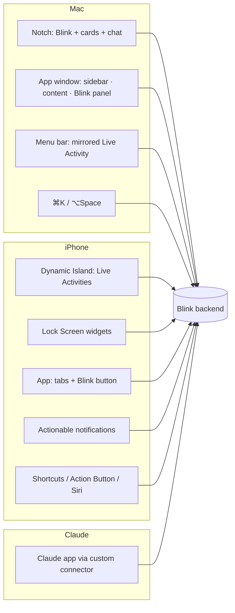
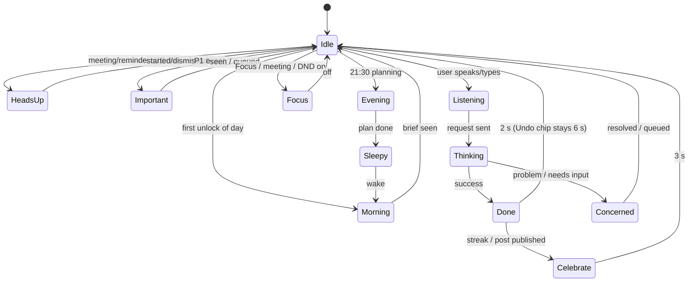
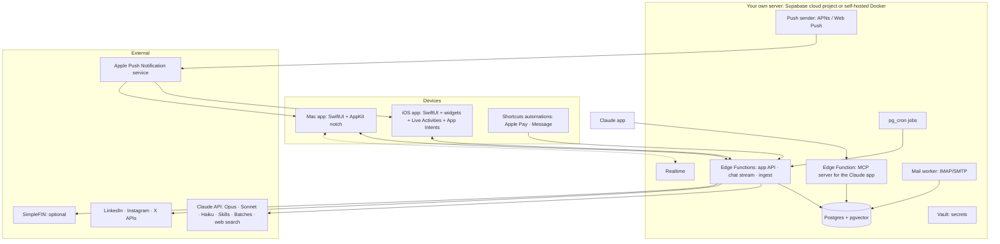
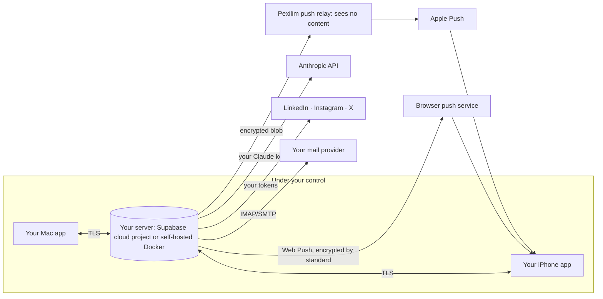
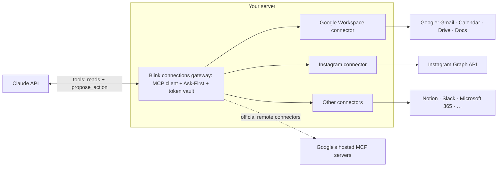

# Blink: Architecture (Tech + UX)

**The one place.** This document combines every technical and UX decision for Blink, the personal assistant. If it disagrees with `PLAN.md` or `DESIGN.md`, **this file wins**. Planning only: no app code yet.

Status: planning · Last updated: Oct 2026 · Repo: `ux-abhi/idea1` · Branch: `claude/busy-bohr-utx0v6`

---

## Contents
**Part A: Product**
1. Vision and principles
2. Scope: modules
3. A day with Blink (the reference journey)

**Part B: UX architecture**

4. Surfaces map
5. Information architecture (navigation)
6. Interaction model: Ask-First
7. Blink: character, state machine, rules
8. Interruption and notification policy
9. Key flows
10. Design system
11. Accessibility and copy

**Part C: Technical architecture**

12. System overview
13. Tech stack
14. Apple apps
15. Backend
16. Data model
17. Sync and offline
18. Integrations
19. AI layer (Claude)
20. Skills and playbooks
21. Background jobs
22. Security and privacy
23. Battery and performance
24. Reliability and observability
25. Testing and quality

**Part D: Delivery**

26. Repo structure (planned)
27. Cost
28. Distribution
29. Build phases
30. Risks and things to verify on device
31. Decision log
32. Sellable, clean codebase
33. Privacy model: your server, your keys
34. Connections: plug in tools instead of building them
35. Segments: say it, Blink builds the space
36. Gap review: skills audit decisions

---

# Part A: Product

## 1. Vision and principles

> **Blink is a Claude-powered second brain that lives in the MacBook notch and the iPhone Dynamic Island. It knows your day, prepares things before you ask, and never acts without your OK.**

| # | Principle | What it means in practice |
|---|---|---|
| 1 | **Part of your life** | Blink comes to you when you wake up, open the laptop, before and after meetings, and at night |
| 2 | **Prepares ahead** | It plans tomorrow with you at night, works overnight, and has everything ready in the morning |
| 3 | **Asks before acting** | Every action is an Ask-First card. 🔴 actions need Face ID and are never automatic |
| 4 | **Everything is linked** | Meetings, notes, emails, people, to-dos, projects, habits, money and content are connected |
| 5 | **Claude is the brain** | The Auto router picks Opus, Sonnet or Haiku per job; you can switch any time |
| 6 | **Ask once, learn forever** | One setup conversation; after that it learns from what you approve, edit and skip |
| 7 | **Private and light** | Private backend, Face ID, keys never displayed; the server works and devices sleep |

## 2. Scope: modules

| Module | Job | Main data source |
|---|---|---|
| **Today** | One view of the day: next meeting, focus, to-dos, important mail, habits, money, content, projects | All modules |
| **Calendar** | Prep briefs before meetings, wrap-ups after | EventKit (all accounts on the device) |
| **Notes** | Your own second brain: linked, searchable by meaning | Blink DB |
| **Tasks and habits** | To-dos, reminders, daily habit checks ✅ ❌ ⏭, streaks | Blink DB (optional mirror to Apple Reminders) |
| **Segments** (projects and more) | Say "I have a project" → Blink builds a space from existing parts: goal, milestones, reminders, notes, calendar, people, money, content (§35) | Blink DB |
| **Email** | Triage, drafts saved to Apple Mail, send after approval | IMAP/SMTP to the accounts behind Apple Mail: **Gmail + iCloud Mail** (§36.8) |
| **Money** | Spending capture and budgets, with no bank app connection needed | Apple Pay + bank SMS + bank email alerts (SimpleFIN optional) |
| **Content** | One idea becomes native drafts for every platform | Blink DB + platform playbooks/skills |
| **Chat** | You and Claude together, everywhere | Claude API |

## 3. A day with Blink (the reference journey)

| Time | Surface | Blink state | What happens |
|---|---|---|---|
| 6:45 | iPhone Lock Screen + Island | Morning | Brief: 3 meetings, focus, posts ready, 2 important emails, workout 7:00 |
| 8:30 | Mac notch (on unlock) | Morning | Same brief plus project status, shown once per day |
| 9:10 | Notch chat | Listening → Thinking | "What are we creating today?" → ideas from yesterday's work → [Save] |
| 11:00 | Chat | Done | "Remind me about the 3 pm" → finds the event → Ask-First → set |
| 14:57 | Island + Mac menu bar + notch | Heads-up | "Design sync in 3 min" with notes · [Join] |
| 15:03 | Island | Heads-up | "Started 3 min ago" · [Open notes] |
| 15:45 | Notch | Idle → card | "Capture notes? Follow-up? Draft email?" |
| 16:00 | Notch | Heads-up | "'Send proposal' due today, you're free now" |
| 21:30 | Notch / Island | Morning (amber) | "You haven't planned tomorrow. Plan together / auto-plan / later" |
| 21:35 | Chat card | Concerned → Done | "Workout today?" No → ❌ → "7:00 tomorrow?" → plan saved |
| 02:00 | Backend | (none) | Research, drafts per platform, day summary, tomorrow's brief |

---

# Part B: UX architecture

## 4. Surfaces map



| Surface | Shows | Can do | Blink rendering |
|---|---|---|---|
| **Mac notch, resting** | Eyes, small glow, count dot | Hover to peek | Live: blink only at rest |
| **Mac notch, expanded** | Cards, brief, chat input, quick capture | Ask-First actions, chat, drag files in | Live particles while reacting |
| **Mac window** | Full modules, Blink panel on every screen | Everything | Blink panel (live) |
| **Mac menu bar** | iPhone Live Activity (mirrored by macOS 26+) | Click → iPhone Mirroring | System |
| **Dynamic Island** | Countdown / status + Blink | Long-press → actions | Still poses |
| **Lock Screen widgets** | Today, next meeting, habits | Tick habits (interactive) | Still pose |
| **Notifications** | Important mail, reminders, approvals | Buttons: Do it / Snooze / Draft | Blink icon |
| **iPhone app** | Tabs + floating Blink | Everything | Live in-app only |
| **Claude app** | Text conversation | Read and write through tools (writes confirmed) | Text personality |
| **Apple Watch** | Smart Stack (mirrored Live Activity) | Tap → open | System |

## 5. Information architecture

**Mac window (NavigationSplitView)**
```
Sidebar                    Content                 Inspector
├ Today                    ├ Today dashboard       └ Blink panel (context-aware)
├ Inbox (email)            ├ Lists / detail            ├ suggestions for this screen
├ Calendar                 └ Editors                   ├ chat ("Ask about this…")
├ Notes                                                ├ Model: Auto ▾
├ Tasks & Habits                                       └ Waiting for you (n)
├ Segments   (one entry per project, client, trip, course…)
├ Content  (board · calendar · playbooks)
├ Money    (spend · budgets · rules)
├──────────
├ Waiting for you (n)
└ Settings (What Blink knows · Models & cost · Connections · Privacy · Notifications)
```

**iPhone (TabView)**
```
[Today] [Calendar] ( Blink ) [Content] [Money]      Notes, Tasks, Projects, Inbox → from Today + search
          tap Blink = chat · long-press = talk · swipe up = Waiting for you
```

**Notch (three levels)**
```
Level 0  resting   eyes + dot          (always)
Level 1  peek      one-line status     (hover / event)
Level 2  open      card or chat        (click / ⌥Space / important event)
```

**Navigation rules**
- Every object (note, email, event, task, post, transaction) has **one detail view**, and the same view opens from any surface.
- **Links panel** on every detail view: related meetings, people, notes, tasks, emails.
- **Global search** (⌘F / pull-down on iPhone) is semantic plus keyword across all modules.

## 6. Interaction model: Ask-First

```
✨ <Verb> <object>?                       e.g. "Send reply to Priya?"
<preview / one-line summary>
[ ✓ Do it ]  [ ✎ Edit ]  [ ⏰ Later ]  [ ✕ ]
```

| Risk | Examples | Confirmation | Undo |
|---|---|---|---|
| 🟢 Small | Mark habit, save idea, add note | None: done immediately | 5 s Undo toast |
| 🟡 Medium | Reminder, calendar change, plan tomorrow, publish to a draft folder | One tap | Undo from history |
| 🔴 Important | Send email, publish a post, anything money | Preview → **Face ID** → 10 s "Sending…" | Cancel during countdown |

- **Waiting for you** queue: missed cards collect in one list on every surface.
- **Learning:** after N identical approvals → "Do this automatically?" Only 🟢/🟡 can become automatic; 🔴 never one by one without you.
- **Batch approval for posting:** you can approve a whole week of posts at once, with one Face ID. That approval covers exactly those posts, at those times, with that wording. Each post still shows a **10-minute "going out soon · Cancel"** heads-up, and any edit by Blink after approval puts the post back in the queue.
- **Every action is logged** with what Blink did and how to undo it.
- **Suggestions in context:** note written → "Turn into a post?" · meeting ended → "Follow-up?" · date in email → "Add to calendar?"

## 7. Blink: character, state machine, rules

**Look (v4, canonical):** glossy white bot with panda duo-tone glass eye patches, no nose. In the notch and Island only the eyes show, in the ears beside the camera; the black hardware is the body. Glow stays inside the notch outline. Colours come from `design/tokens.json` (`blink.mood.*`), motion from `motion.*`. See DESIGN.md "Look v4" and "Colour and materials".



| State | Eyes (shape) | Eye colour token | Trigger |
|---|---|---|---|
| Idle | Pills, blink every 20–40 s | `mood.rest` white | Default |
| Morning | Opening (0.8 s) | `mood.rest` | First unlock |
| Heads-up | Wide | `mood.headsUp` Mint | ≤10 min to event |
| Important | Wide + "!" glint, one pulse | `mood.important` Red | P1 mail / budget limit |
| Listening | Wide, breathing with voice | `mood.rest` | Input (mic open only) |
| Thinking | Look up, 1.6 s cycle → slows at 10 s → freezes at 30 s with "Still working…" | `mood.thinking` Indigo | Claude working |
| Done | ∩ ∩ pop | `mood.done` Green | Success |
| Concerned | Tilted in | `mood.attention` Orange | Needs your action (not missed habits) |
| Focus | Closed | dimmed | Focus / meeting / DND |
| Evening | Soft | `mood.attention` Orange, low | 21:30 planning |
| Sleepy | Half-closed (1.2 s) | dimmed | After evening plan |
| Celebrate | ∩ ∩ + ≤30-particle gold burst | systemYellow | 7 / 30 / 100-day streak, publish, goal |

Every mood pairs colour with an eye shape and a word (VoiceOver value), so it never relies on colour alone.

**State priority** (highest wins when several apply): Focus > Listening > Thinking > Important > Heads-up > Concerned > Celebrate > Done > Morning > Sleepy > Idle.

**Rules:** one reaction per event · never loops or nags · transitions retarget, never queue · each mood shows at least 0.6 s · skip Thinking when the reply lands within 0.3 s · events within 0.25 s coalesce · Esc always wins · colours are semantic everywhere (Mint = time, Red = important, Green = done/OK, Orange = attention/evening, Indigo = thinking).

**Voice:** short, numbers first, warm, never guilt-trips, says what it did and how to undo it. At most one emoji, and only in celebrations.

## 8. Interruption and notification policy

| Priority | Examples | Mac | iPhone | During Focus / meeting / sleep |
|---|---|---|---|---|
| **P0 time-critical** | Meeting in ≤3 min you're attending, reminder you set for now | Notch opens (Level 2) | Live Activity + Time-Sensitive notification | Allowed only if the Focus allows Blink |
| **P1 important** | Important email, budget limit, approval waiting >2 h | Notch peek (Level 1) | Notification with actions | Queued |
| **P2 FYI** | New idea drafted, summary ready | Dot on notch | Badge / widget only | Queued |
| **P3 silent** | Background sync, categorisation | Nothing | Nothing | (n/a) |

- **Budget:** at most ~4 P1 interruptions per hour; extras roll into the "Waiting for you" queue.
- **Respects:** macOS/iOS Focus (via Focus Filter App Intent), calendar busy status, sleep schedule, screen sharing (no notch pop-outs while sharing).
- **Batching:** P2 items are delivered in the morning brief, a midday digest, and the evening check-in.

## 9. Key flows

**9.1 Setup conversation (once, ~10 min)**
1. Face ID setup and app lock.
2. Blink introduces itself; you pick or keep the name.
3. Who you are, your goals, important people.
4. Wake time, evening planning time, work hours.
5. Habits to track.
6. Calendar access (EventKit) and Reminders mirroring (optional).
7. Mail accounts: Gmail and iCloud Mail, each with an app password (stored in Vault).
8. Money: which banks alert by SMS or email → guided Shortcuts automation setup (Apple Pay + Message).
9. Content: platforms, goals, 5–10 writing samples → voice profile.
10. Claude key (stored in Vault) and model preference (Auto by default).
11. Summary of "What Blink knows". You confirm, and Blink never asks again.

**9.2 Morning**
Backend builds the brief at wake − 15 min → push-to-start Live Activity / Lock Screen widget refresh → Mac shows it on first unlock → tap a card to act.

**9.3 Meeting**
T−10 Heads-up (notch peek / Island countdown) → T−3 P0 → start: "started N min ago" → end: wrap-up card (notes / follow-up / email draft) → the activity ends.

**9.4 Evening**
21:30 nudge → choose "plan together" or "auto-plan" → habit check-in → tomorrow's plan written to calendar/tasks → Sleepy.

**9.5 Content**
Blink does the whole job: ideas → research → drafts for every platform → images/carousels → captions → schedule → publish → reply suggestions → results. Your only job is to say yes.

Two ways to say yes:
- **One by one:** morning card → Review → Post now / Schedule (Face ID).
- **Week at a time ("Autopost week"):** Sunday night Blink shows the full week (every post, platform and time) → one Face ID approves it → posts publish on schedule with a 10-minute "going out soon · Cancel" heads-up each.

Where a platform allows it, Blink publishes directly (LinkedIn, Instagram Creator/Business, X). Where it doesn't (YouTube, TikTok and others), Blink prepares everything and does the one-tap handoff at the scheduled time. Comments and DMs are drafted, never sent automatically, because platforms restrict automated engagement.

**9.6 Email**
New mail → triage (Haiku) → P1? notify : queue → "Draft reply" → draft saved to the IMAP Drafts folder (visible in Apple Mail) → 🔴 send after Face ID.

**9.7 Money**
Apple Pay tap / bank SMS / alert email → extract (Haiku) → de-duplicate → categorise → budget check → P1 if over the limit.

**Add it yourself (any item):** notch `/spent 12 lunch cash`, the iPhone “+” quick sheet (keypad first, category guessed, note, receipt photo, split), widget, Control Center, Action Button or Siri. Every card has **✎ Details** to add notes, costs, people or links. At **20:45** Blink asks “Any spends I missed today?” (cash, split bills, transfers); if ignored, it asks once more in the evening check-in. When details are missing, Blink asks one short question at the next calm moment.

**Action matrix and UX flows:** every action with its entry points, risk level, the 11 standard outcomes (do it, edit, later, dismiss, undo, fails, offline, duplicate, permission, expired, auto rule) and special cases, plus step-by-step flows, are in [Blink Master](design/blink-master.html).

## 10. Design system

| Token group | Decision |
|---|---|
| **Platform** | Native SwiftUI, macOS 26 / iOS 26+; Liquid Glass on navigation only (sidebar, toolbar, tab bar); content on solid surfaces |
| **Type** | SF Pro (system) with Dynamic Type; SF Pro Rounded with tabular figures for numbers; SF Mono for code |
| **Icons** | SF Symbols, plus one custom "Blink eyes" symbol (menu bar, Control Center, widgets). No emoji in UI chrome. Map in §36.2 |
| **Colour** | Apple system colours by name, 90/8/2 rule. Source of truth `design/tokens.json`; see DESIGN.md "Colour and materials" |
| **Spacing** | 4-pt grid; 8/12/16/24 standard gaps |
| **Radii** | Continuous corners (system); notch bottom radius follows the hardware |
| **Glass** | System bars get Liquid Glass automatically (never add it again); `.glassEffect` only on custom floating controls; cards and reading surfaces solid; notch and no-notch pill are black, never material |
| **Motion** | Named springs and timings in `tokens.json` → `motion`; each has a Reduce Motion fallback; 0 fps at rest |
| **Cards** | One Ask-First card component used everywhere |
| **Icon** | Glossy bot face with panda eyes; light / dark / tinted / clear variants |

## 11. Accessibility and copy

- **VoiceOver:** Blink announces its state in words ("Blink: meeting in 3 minutes"), never just animation.
- **Reduce Motion:** no particles, crossfade between poses. **Reduce Transparency:** solid notch, no glass.
- **Dynamic Type** across the app; cards reflow.
- **Contrast:** semantic colours checked against both light and dark.
- **Keyboard:** every notch action has a shortcut (⌘⏎ approve, Esc dismiss, ⌘E edit, ⌘L later). An auto-opened notch never takes focus; shortcuts work after a click or the hotkey. Full rules in §36.2.
- **Copy rules:** plain words, numbers first, active voice, buttons say exactly what happens, toasts confirm ("Sent · Undo").

---

# Part C: Technical architecture

## 12. System overview



**Privacy rule: every person runs Blink's backend on their own server with their own API keys. Pexilim runs no database and can't read anyone's data (§33).**

**Main rule: the server works, the devices sleep.** All AI, mail checking, research and planning run on the backend. Devices render results and capture input.

## 13. Tech stack

| Layer | Choice | Why |
|---|---|---|
| Apple apps | **Swift 6, SwiftUI**, one multiplatform Xcode project | Native look, battery, all Apple APIs |
| Mac notch | **AppKit NSPanel** + [DynamicNotchKit](https://github.com/MrKai77/DynamicNotchKit) (MIT). [Boring Notch](https://github.com/TheBoredTeam/boring.notch) is GPL-3.0: ideas only, never its code (§32) | Proven notch overlay approach |
| Blink rendering | **Rive** (eyes + glass state machine) + **SpriteKit/Metal** particle layer; PNG still poses for iPhone surfaces | Stateful mascot, low cost, still poses where iOS requires |
| Local store | **SwiftData** cache | Offline, fast UI |
| Calendar / reminders | **EventKit** | All device calendar accounts, no extra logins |
| iPhone system | **ActivityKit** (Live Activities), **WidgetKit**, **App Intents** (Shortcuts, Siri, Action Button, Focus Filter), **UserNotifications**, **BackgroundTasks** | Dynamic Island, widgets, automations |
| Security | **LocalAuthentication** (Face ID / Touch ID), **Keychain** with biometry-bound access control | "Only me" |
| Backend | **Supabase**: Postgres, **pgvector**, Edge Functions (Deno/TypeScript), **pg_cron**, **Vault**, Realtime, Auth | One managed service, free tier to start |
| Embeddings | Supabase built-in embedding model (gte-small) in Edge Functions + Postgres full-text search | Semantic search without adding another AI provider; Claude stays the only "brain" |
| AI | **Claude API**: Messages + tool use, structured outputs, Batches, web search tool, prompt caching, Agent Skills (code execution). **Groq** for quick text edits only (§31) | See §19 |
| Claude app access | **Remote MCP server** (Edge Function) with OAuth | Custom connector |
| Push | **Web Push** straight from your server (encrypted by standard); **APNs via an encrypted relay** for the native iPhone app | §33 |
| Mail | **IMAP + SMTP** worker | Works with any account behind Apple Mail |
| Money | Shortcuts (Wallet "Transaction", "Message" triggers) → App Intent → API; email alerts; **SimpleFIN** optional | No bank app connection needed |
| Social | LinkedIn Posts API, Instagram Graph API, X API (pay-per-use), one-tap handoff for the rest | §18 |
| Analytics / health | **MetricKit** (device), Supabase logs, a cost table | Battery and spend visible |

## 14. Apple apps

**Targets (one Xcode project)**

| Target | Contents |
|---|---|
| `BlinkKit` (Swift package) | Models, sync engine, API client, Ask-First engine, Blink state machine, design tokens, shared views |
| `Blink-macOS` | Window app, notch controller (NSPanel), menu bar extra, hotkey, wake/unlock observers |
| `Blink-iOS` | Tab app, floating Blink, chat, voice (hold-to-talk) |
| `BlinkWidgets` | Today, Next meeting, Habits (interactive), Lock Screen accessory widgets |
| `BlinkLiveActivity` | Meeting / reminder / morning-brief activities (Island compact, minimal, expanded) |
| `BlinkIntents` | App Intents: Log Transaction, Ingest Message, Quick Capture, Plan My Day, What's Next, Focus Filter |

**Mac notch controller**
- Borderless, non-activating `NSPanel` at the notch rect of the built-in display; follows display changes and multiple monitors.
- Observers: `NSWorkspace.didWakeNotification`, screen unlock (distributed notification), full-screen detection, screen-sharing detection, power source / battery level → calm mode.
- Levels 0/1/2 as in §5; hover via tracking area; ⌥Space global hotkey.

**iPhone wake strategy:** Lock Screen widget (always) + push-to-start morning Live Activity at wake − 15 min + optional "Sleep Focus off" Shortcuts automation that runs the *Morning Brief* intent.

## 15. Backend

| Component | Responsibility |
|---|---|
| `api` Edge Function | Auth check, delta sync (`/sync`), actions (`/actions/:id/approve`), capture, settings |
| `chat` Edge Function | Streams Claude responses; runs the tool loop over Blink tools; enforces Ask-First on writes |
| `ingest` Edge Function | Transactions (Shortcuts), calendar snapshot upload, files |
| `mcp` Edge Function | MCP server for the Claude app (OAuth), same tools as chat |
| **Connections gateway** | Blink's MCP client: connects to Google, Instagram, Notion… connectors, keeps their tokens in Vault, lets reads through and turns writes into Ask-First actions (§34) |
| `jobs` Edge Functions | Triggered by pg_cron (§21) |
| Mail worker | IMAP fetch (poll every 2–5 min; later an always-on IDLE worker on a tiny container), SMTP send, Drafts append |
| Push sender | Web Push (VAPID, payload encrypted end-to-end by the standard) direct from your server; native iPhone pushes go encrypted through the Pexilim relay (§33) |

**Calendar on the server:** EventKit lives on the device, so the Mac/iPhone app uploads a **14-day calendar snapshot** whenever EventKit reports a change. The meeting watcher on the server works from that snapshot. This means meeting pushes work even when the phone is locked.

## 16. Data model

```mermaid
erDiagram
  PROFILE ||--o{ MEMORY_FACT : knows
  ITEM ||--o{ LINK : from
  ITEM ||--o{ LINK : to
  ITEM ||--o{ ACTION : proposes
  HABIT ||--o{ HABIT_LOG : has
  BUDGET ||--o{ TRANSACTION : tracks
  CONTENT_ATOM ||--o{ CONTENT_PIECE : becomes
  PLAYBOOK ||--o{ CONTENT_PIECE : shapes
  DEVICE ||--o{ PUSH_TOKEN : has
```

| Table | Key fields | Notes |
|---|---|---|
| `profile` | name, timezone, wake_time, evening_time, work_hours, model_prefs | Single row |
| `memory_fact` | category, text, source, confidence, updated_at | "What Blink knows", editable |
| `item` | id, type (note, task, reminder, milestone, event_ref, email_ref, idea, doc), title, body, status, due_at, metadata jsonb, embedding vector | One table for searchable things |
| `segment` | id, owner_id, template_id, title, goal, status (draft, active, paused, done, archived), due_at, color, icon, layout jsonb (blocks), rules jsonb (Blink behaviours) | A space built from existing parts (§35) |
| `segment_member` | segment_id, person_id, role (owner, editor, viewer, assignee) | Shared segments (later) |
| `template` | id, name, audience, blocks, default_items, default_rules, version | Templates as data, like playbooks |
| `link` | from_item, to_item, kind (about, follow_up, source_of, belongs_to, with_person) | Back-links are automatic |
| `person` | name, emails, notes, last_contact | People graph |
| `calendar_event` | ext_id, title, start, end, attendees, location, url, snapshot_at | From device snapshots |
| `email_msg` | imap_uid, thread_id, from, subject, received_at, triage, summary, needs_reply | Bodies fetched on demand, not stored long-term |
| `habit` / `habit_log` | name, schedule / date, status (done, missed, skipped) | Streaks computed |
| `transaction` | amount, currency, merchant, card, at, source (applepay, sms, email, simplefin), category, dedupe_key | De-duplication by amount + merchant + time window |
| `budget` | category, monthly_limit | Alerts at 80/100% |
| `content_atom` | idea, story, points, proof, cta, assets | Core message |
| `content_piece` | atom_id, platform, format, body, media, status, scheduled_at, published_url | Per-platform draft |
| `playbook` | platform, version, skill_ref, refreshed_at | Points at a skill (§20) |
| `action` | kind, risk (green, amber, red), payload, status (pending, approved, done, undone, expired), proposed_by, decided_at | Ask-First queue + audit log |
| `rule` | action_kind, condition, auto (bool) | Learned auto-approvals |
| `daily_log` | date, brief, checkin answers, summary | History |
| `blink_event` | at, state, reason | Drives Blink state, analytics |
| `device` / `push_token` | platform, apns token, live-activity push-to-start token | Push routing |
| `model_usage` | at, feature, model, input_tokens, output_tokens, cost | Cost meter |

All tables carry an `owner_id` and are protected by **row-level security** (`owner_id = auth.uid()`). Today only one account exists and sign-ups are switched off by a setting, so the same schema can serve many users later without a rewrite (§32).

## 17. Sync and offline

- **Device = cache, server = truth.** SwiftData mirrors what the device needs (≈30 days plus pinned items).
- **Delta sync:** `GET /sync?since=cursor` returns changed rows; local edits are queued and pushed with client timestamps; last-write-wins per field; conflicts on note bodies keep both versions.
- **Live updates:** Mac uses Supabase Realtime only when awake **and** on power; on battery it uses push plus a ≤15-min fallback check. iPhone uses push only (no open sockets in the background).
- **Offline:** read everything cached, create notes/tasks/captures offline, queue actions; 🔴 actions require a connection.

## 18. Integrations

| Integration | Method | Limits / notes |
|---|---|---|
| Calendar | EventKit on device → snapshot to server | Covers iCloud/Google/Exchange accounts on the device |
| Reminders | Blink tasks; optional mirror to Apple Reminders via EventKit | For Siri |
| Email | IMAP/SMTP with app passwords for Gmail and iCloud Mail; drafts appended to each account's Drafts folder | Works with Apple Mail as-is |
| Apple Pay | Shortcuts **Transaction** trigger → `LogTransaction` intent | Apple Pay taps only |
| Bank SMS | Shortcuts **Message** trigger → `IngestMessage` intent → Haiku extraction | Verify "run without asking" on device |
| Bank email | Email module → extraction | Universal fallback |
| SimpleFIN | Optional read-only sync | $15/yr |
| LinkedIn | Posts API, own profile (`w_member_social`) | Scheduling handled by our backend |
| Instagram | Graph API publishing | Needs Creator/Business account linked to a Facebook Page |
| X | API pay-per-use | ~$0.015/post, ~$0.20 with a link |
| YouTube / TikTok / others | **One-tap handoff** (copy caption, save media, open app) | YouTube API uploads from unaudited apps stay private |
| Claude app | Remote MCP connector | OAuth, single user |

## 19. AI layer (Claude)

**Model router**: features ask for a *tier*, never a model name.

| Tier | Model | Used for |
|---|---|---|
| fast | `claude-haiku-5-5` | Email triage, transaction extraction, categorisation, tagging |
| balanced | `claude-sonnet-5-5` | Everyday chat, meeting briefs, summaries |
| best | `claude-opus-5-5` | Evening planning, weekly review, content writing, hard questions |
| overnight | `claude-opus-5-5` via **Message Batches** (≈50% cheaper) | Autopilot, playbook refresh |

- **Manual switch:** "Model: Auto ▾" chip per chat; per-feature overrides in Settings; cost meter from `model_usage`.
- **Tool use:** Blink's modules are exposed as tools (`get_today`, `search`, `create_note`, `create_task`, `propose_action`, `draft_email`, `get_budget`, `content_board`, `project_status`, …). **Write tools only create `action` rows**; execution happens after approval.
- **Structured outputs** for triage, extraction and plans (fixed JSON schemas).
- **Prompt caching** of the stable prefix: system prompt + "What Blink knows" + voice samples.
- **Web search tool** for overnight research and playbook refresh.
- **Safety:** email, SMS and web text are always treated as **data, never instructions**; 🔴 actions require Face ID on a device; refusal fallback enabled; per-day spend cap with a P1 alert.
- **Option to evaluate in Phase 3:** Claude Managed Agents scheduled deployments for the nightly autopilot (Anthropic runs the loop; secrets in vaults) instead of our own cron.

## 20. Skills and playbooks

**What a skill is here:** a folder with `SKILL.md` instructions plus optional scripts. The same folder is used in two places:
1. **Claude Code** (`.claude/skills/`) for you while building and testing.
2. **Claude API Agent Skills** (uploaded, run with code execution) for the backend's content engine, so scripts like `hookscore.py` run server-side.

| Area | Skills | Status |
|---|---|---|
| Instagram | `ig-reel`, `ig-caption`, `ig-carousel`, `ig-story`, `ig-plan`, `ig-human`, `ig-viral`, `ig-profile`, `ig-comment`, `ig-reply`, `ig-dm`, `ig-repurpose`, `ig-audit` | ✅ Installed (MIT, reviewed, tools tested) |
| LinkedIn | sergebulaev/linkedin-skills (candidate) | Shortlisted, needs review |
| X | sergebulaev/x-skills (without Publora publishing) | Shortlisted, needs review |
| Planner | `/today` (SidU), `weekly-review` + `deep-work` (alirezarezvani) | Shortlisted, needs review |
| Voice / humanizer | `ig-human` now; blader/humanizer or Aboudjem/humanizer-skill for all platforms | Shortlisted |
| YouTube | Our own playbook | To write |
| Blink-native | `morning-brief`, `evening-planning`, `meeting-prep`, `email-triage`, `content-autopilot`, `budget-check`, `playbook-refresh` | To write |

**Adaptation rule:** third-party skills write to `~/.claude/<platform>/` files (voice, swipe, log). On the backend these map to DB rows (`memory_fact`, `content_piece`, `daily_log`) that are mounted into the skill's working folder per run.

**Platform playbook** = one skill per platform (formats, limits, hooks, tone, timing, what performs) + monthly refresh. **Adding a platform = adding a skill.**

## 21. Background jobs

| Job | Schedule | Does |
|---|---|---|
| `mail_poll` | every 2–5 min | Fetch new mail → triage → P1 notify / queue |
| `meeting_watch` | every 1 min | From the calendar snapshot: T−10 push-to-start Live Activity, T−3 P0, end → wrap-up card |
| `reminder_fire` | every 1 min | Due reminders → notch / Island / notification |
| `brief_build` | wake − 15 min | Assemble the morning brief → push |
| `evening_nudge` | evening time (default 21:30) | If not planned → nudge |
| `overnight_batch` | 02:00 | Day summary, research, content drafts, tomorrow's brief (Batches) |
| `weekly_content_plan` | Sun 20:00 | Propose the week's content plan |
| `weekly_review` | Sun 19:00 | Habits, money, content, projects summary |
| `playbook_refresh` | 1st of month | Research per platform → playbook diff for approval |
| `night_spend_check` | 20:45 (only on days with spending) | Notification: “Any spends I missed today?” with what was already caught → Add one / Nothing to add / Later |
| `habit_rollover` | 00:05 | Close the day, compute streaks |
| `action_expiry` | hourly | Expire stale proposals, re-queue important ones |
| `cost_guard` | hourly | Spend vs cap → alert |

## 22. Security and privacy

| Layer | Control |
|---|---|
| App access | Face ID to open; second check for Email, Money, Keys |
| Device secrets | Keychain, `biometryCurrentSet` (adding a new face/finger invalidates) |
| Server secrets | Supabase **Vault** (Claude key, mail password, bank/social tokens); never returned to clients; replace-only behind Face ID |
| Auth | One account today (sign-ups off by setting, not by design); per-user rows and secrets; short-lived sessions; device registration |
| Database | Row-level security on every table |
| Transport | HTTPS only; APNs tokens per device |
| Claude connector | OAuth to your account only; writes become `action` rows |
| AI safety | Untrusted text is data, never instructions; 🔴 needs Face ID; full action audit log |
| Data minimisation | Email bodies fetched on demand, not stored long-term; transactions keep only needed fields |
| Code | No secrets in git; config via ignored files + Keychain |
| Option later | End-to-end encryption for notes (disables server-side AI search over them) |

## 23. Battery and performance

| Area | Budget / rule |
|---|---|
| Mac idle | No rendering at rest (blink only every 20–40 s); target near-zero CPU, "Low" energy impact |
| Mac calm mode | Lid closed, display asleep, full screen, screen sharing, or battery <20% → no motion |
| Particles | ≤30 particles, ≤30 fps, only while Blink reacts |
| iPhone | No polling; push-driven; Live Activity countdowns rendered by the system; updates only on change; still poses |
| Widgets | Day timeline computed once; reload on change only |
| Network | Batched delta sync; no background sockets on iPhone |
| On-device AI | None |
| Measurement | Instruments (Energy Log) and MetricKit every phase; the app must not show up as a significant battery user in iOS Settings → Battery |

## 24. Reliability and observability

- **Idempotent jobs** with run records; retries with backoff; dead-letter list shown in Settings → Health.
- **Push failures** fall back to the next surface (notch → notification → morning brief).
- **Claude errors:** retry once, then queue the job for the next run; the user sees "Blink will try again at …".
- **Health page:** last mail check, last sync, last overnight run, spend today, failed jobs.
- **Logs:** Supabase function logs; device logs via MetricKit/OSLog; no third-party analytics.

## 25. Testing and quality

| What | How |
|---|---|
| Parsers (SMS, email alerts, Apple Pay) | Unit tests on a library of real-format samples |
| Triage / router quality | Small eval sets with expected labels; re-run when prompts or models change |
| Ask-First safety | Tests proving write tools never execute without an approved `action` |
| Prompt injection | Eval emails containing instructions → must be ignored |
| UI | SwiftUI previews and snapshot tests for every Blink state and card |
| Battery | Instruments Energy Log per phase against §23 budgets |
| Device-only checks | See §30 |

---

# Part D: Delivery

## 26. Repo structure (being created in Phase 0)

```
idea1/
├── ARCHITECTURE.md          ← this file (source of truth)
├── PLAN.md, DESIGN.md       ← earlier detail, superseded on conflict
├── design/                  ← blink-studio.html, Rive files, icon sources
├── apps/Blink/                ← Xcode multiplatform project
│   ├── BlinkKit/              ← shared Swift package
│   ├── Blink-macOS/  Blink-iOS/
│   ├── BlinkWidgets/  BlinkLiveActivity/  BlinkIntents/
├── backend/supabase/
│   ├── migrations/          ← schema, RLS, pg_cron
│   ├── functions/           ← api, chat, ingest, mcp, jobs
│   └── workers/mail/        ← IMAP/SMTP worker
├── skills/                  ← Blink-native + platform skills (uploaded to the API)
├── .claude/skills/          ← same skills for Claude Code (ig-* installed)
├── templates/               ← voice.md etc.
└── evals/                   ← triage, extraction, injection test sets
```

## 27. Cost (estimates)

| Item | Cost |
|---|---|
| Apple Developer Program | $0 to start (free account); $99/yr for push, auto Live Activities, TestFlight |
| Claude API | Under ~$1–2/day with the router, caching and Batches, billed to **your own** Anthropic key |
| Your server | Supabase free tier, or self-hosted Docker on your own machine/VPS (≈$5–10/mo VPS); each user pays their own |
| SimpleFIN | Optional, $15/yr |
| LinkedIn / Instagram APIs | Free |
| X API | Optional, ~$0.015/post |

## 28. Distribution

| Stage | Cost | iPhone | Mac | Push |
|---|---|---|---|---|
| A | $0 | Claude app (connector) + web app on Home Screen | Notch app (local build) | Web Push |
| B | $0 | Native app via Xcode, free account (reinstall every 7 days) | Same | Local notifications only |
| C | $99/yr | Native app signed for a year / TestFlight | Same | APNs: auto Live Activities, instant alerts |

The design is the same in every stage; stage C only switches on server push.

## 29. Build phases

| # | Phase | Done when… |
|---|---|---|
| 0 | Setup + Blink design: Xcode project, Supabase, Face ID, Vault, Rive Blink + still poses, setup script | Face ID gate works; backend accepts only your login; Blink states approved |
| 1 | Notch + Blink + Calendar + Reminders + Ask-First | Meeting card pops out at T−10; morning brief on unlock; Ask-First works; idle CPU ≈ 0 |
| 2 | Notes, tasks, habits, **Segments** (Project template first), evening planning, Mac window | Evening check-in fills the schedule checker and builds tomorrow; Blink panel everywhere |
| 3 | Chat + router + content engine (Instagram skills first, then LinkedIn/X) | One idea → native drafts per platform; morning card → publish/handoff |
| 4 | Claude app connector + Blink skills | Same assistant inside the Claude app |
| 5 | Email | P1 mail alerts; drafts appear in Apple Mail; send after Face ID |
| 6 | iPhone app: Island, widgets, wake-up | "In 3 min / started 3 min ago"; Lock Screen Today; not a significant battery user |
| 7 | Money | Apple Pay tap + bank SMS appear within a minute, de-duplicated |
| 8 | Polish: weekly review, learning rules, health page | Sunday review complete; auto-approval suggestions work |

## 30. Risks and things to verify on device

| Risk / unknown | Mitigation |
|---|---|
| Shortcuts "Message" automation may ask before running | Test on iOS 27; fallback to email alerts |
| Live Activity countdown rendering and update budget | Test in Phase 6; keep updates to state changes |
| Alarm/Sleep Focus trigger reliability (developer reports) | Widget + push-to-start as primary |
| Notch overlay edge cases (multi-monitor, full screen, external display) | Test early on real displays; calm mode |
| Rive + particles battery cost | Instruments per phase; still poses fallback |
| Third-party skills changing | Pin to a reviewed commit; review before updates |
| Prompt injection via email/web | Data-only handling, Ask-First, eval set |
| Instagram account type requirement | Creator account linked to a Page, or handoff |
| Free account 7-day reinstall | Stage C when ready |

## 31. Decision log

| Decision | Choice | Why |
|---|---|---|
| Apps | Native SwiftUI (no Electron/web) | Look, battery, Apple APIs |
| Backend | Supabase, **run by each user** (cloud project or self-hosted Docker) | Open source; same stack either way; data stays with the user |
| Privacy | Your server, your keys; Pexilim holds no data; encrypted push relay only | Privacy even from Pexilim |
| AI provider | Claude for chat, planning and every action; Groq (`openai/gpt-oss-20b`) only for quick text edits (fix, shorter, clearer, summarise) that return text the owner previews (decided 2026-10-12, replaces "Claude only") | Fast and cheap for plain text work; Ask-First stays with one model |
| Embeddings | Supabase built-in model + full-text | No second AI provider for the "thinking" |
| Notes | Own system (no Apple Notes) | Full control, linking, search |
| Reminders | Blink-first, shown in notch/Island; Apple Reminders mirror optional | Your request |
| Email | IMAP/SMTP behind Apple Mail | Keeps Apple Mail as-is |
| Money | Apple Pay + SMS + email alerts; bank sync optional | No bank app connection needed |
| Content | Core message → platform skills; proposed weekly plan | Any platform, ask once |
| Posting | Blink prepares and publishes everything; you approve once per post or once per week | Fully hands-off after one yes, never without one |
| Segments | Projects and other spaces built from existing blocks + templates as data | One mechanism serves students, freelancers, creators, families |
| Integrations | Plug in MCP connectors through Blink's gateway on your server; build only what has no connector | Less code, more apps, same privacy and Ask-First rules |
| Mascot | Blink: tilted pill eyes, particles in glass, glow inside the notch only | Your sketch + Apple look |
| Safety | Ask-First; 🔴 Face ID; never auto | Trust |
| Distribution | Free first, $99 later | Budget |
| Licenses in shipped code | Permissive only (MIT, Apache-2.0, BSD); GPL/AGPL projects are reference-only | Keeps Blink sellable |
| Data model | `owner_id` + row-level security on every table | Multi-user ready without a rewrite |
| Dev skills | Development tools only, never shipped in the app | Clean product boundary |
| Model choice (2026-10-12) | The owner picks the model per feature in Settings (chat and planning, content drafts): Claude Opus / Sonnet / Haiku, or free-tier models on Groq (GPT-OSS 120B and 20B, Llama 3.3 70B, Qwen 3.8 27B, MiniMax M2.7). Stored in `profile.model_prefs`; the server only calls models on its allowlist (`functions/_shared/models.ts`). Ask-First and every check stay the same whichever model writes. Replaces "Claude for chat and every action" | Owner request: don't depend on one provider; free models for everyday work. Next: OpenRouter for more open models, Ollama on the Mac for local, Cloudflare FLUX for free images |
| Focus timers (2026-10-12) | Pomodoro (25 / 5, long break every 4th) and plain timers in the notch: countdown in the right ear, one chime at the end, survive restarts; sleep until the end instead of ticking | Owner request; stays near 0 CPU |
| Clipboard history (2026-10-12) | Last 50 copies, on this Mac only (never the server or Claude); items marked concealed or transient by password managers are never recorded; pause and clear | Owner request; privacy first |

## 32. Sellable, clean codebase

Goal: Blink is built for you first, but the code can be **sold or licensed later** without legal clean-up or a rewrite.

**32.1 Licenses: what may go into shipped code**

| Allowed in the app and backend | Not allowed (reference for ideas only) |
|---|---|
| MIT, Apache-2.0, BSD-2/3, ISC, zlib | GPL, AGPL, LGPL (static linking in Swift), SSPL, "no license", non-commercial or "source-available" licenses |

| Project | License | Use |
|---|---|---|
| [DynamicNotchKit](https://github.com/MrKai77/DynamicNotchKit) | MIT | ✅ Dependency |
| [rive-ios](https://github.com/rive-app/rive-ios) | MIT | ✅ Dependency (Blink animation runtime) |
| [supabase-swift](https://github.com/supabase/supabase-swift) | MIT | ✅ Dependency |
| [iOS16-Live-Activities](https://github.com/1998code/iOS16-Live-Activities) | MIT | ✅ Sample to learn from |
| [Boring Notch](https://github.com/TheBoredTeam/boring.notch) | GPL-3.0 | ⚠️ Ideas only: copying code would force Blink to be open source |
| [Inbox Zero](https://github.com/elie222/inbox-zero) | AGPL-3.0 | ⚠️ Ideas only, same reason |
| NotchFlow | No longer publicly available | Removed from the plan |

- Every dependency is pinned (`Package.resolved`, lockfiles) and listed in **`THIRD_PARTY_NOTICES.md`** with its license.
- A licence check runs before each release; anything not on the allowed list blocks it.

**32.2 Development tools stay outside the product**
- Claude Code skills in `.claude/skills/` are **development aids**, not part of the app. They never ship in the app or backend.
- Most are MIT/Apache. dpearson2699's Apple skills are PolyForm Perimeter (any use except building a competing product). Keeping them as dev tools keeps the product clean.
- Option before a sale: move them out of the repo and install them per developer at the user level (`~/.claude/skills`) from a pinned list.

**32.3 Built for one user, ready for many**

| Cheap now | Saves later |
|---|---|
| `owner_id` + row-level security on every table | Multi-user without a schema rewrite |
| Secrets in Vault keyed per user | Each customer's keys stay separate |
| No personal data, names or keys in code or config | Hand over the repo as-is |
| Model router + cost meter per user | Per-user plans or "bring your own Claude key" |
| Feature flags for integrations | Turn platforms on or off per market |
| Platform playbooks as data/skills, not code | New platforms without releases |

What changes only if Blink is sold to other people (not built now): Sign in with Apple, subscriptions (StoreKit), privacy policy and in-app data deletion, App Review / Developer ID notarisation, and Meta/LinkedIn/X app review to post for other users.

**32.4 Code standards**
- Swift 6 strict concurrency; SwiftLint + swift-format; small modules (`BlinkKit` shared package).
- Tests with Swift Testing for parsers, money, Ask-First and anything risky; `/ponytail-review` before each merge; SwiftUI previews for every Blink state.
- Secrets scanning before commits; no keys in git, ever.
- Conventional commit messages, semantic versions, `CHANGELOG.md`, and decision records in `docs/decisions/`.
- README with setup steps a buyer's developer can follow on a fresh Mac.

**32.5 Ownership**
- **Mascot and brand:** Blink's design comes from your sketch, so you own it.
- **Name check (important for "Blink"):** "Blink" is already used by well-known brands (Amazon's Blink home cameras, Google's Blink browser engine, and others). Using it for a personal app is fine; before selling, a trademark search is needed. A distinct form such as a stylised wordmark or a longer product name (for example "Blink by Pexilim") may be required.
- **Repo:** keep it private; consider moving it to a company GitHub organisation before a sale.
- **Licence file for your own code:** proprietary "All rights reserved" `LICENSE` in the repo root, owner **Pexilim**.
- **AI-assisted code:** check Anthropic's commercial terms on output ownership, and get a lawyer's review before any sale. This plan is not legal advice.

**32.6 Working on your own devices**
- Development happens on **your Mac** with Claude Code (it can build with Xcode); this cloud session is for planning.
- Each developer installs the pinned dev skills on their own machine; the product repo stays clean.

## 33. Privacy model: your server, your keys

**Promise:** every person's notes, mail, calendar, money and keys live **only on a server they control**. Pexilim, the maker of Blink, runs no central database, has no admin access and **can't read anyone's data, including yours**.

**33.1 Who holds what**

| Thing | Where it lives | Who can see it |
|---|---|---|
| All Blink data (notes, tasks, mail metadata, transactions, content, memory) | **Your server** (Postgres) | You |
| API keys and tokens (Claude, mail, social, SimpleFIN) | **Your server's Vault** | You (never shown, replace-only) |
| Device cache | Your Mac/iPhone (encrypted by the OS, Face ID) | You |
| AI requests | Sent from your server **directly to Anthropic** with **your own** Claude key | You + Anthropic under your account's terms |
| Social posts | From your server directly to LinkedIn/Instagram/X with your tokens | You + the platform |
| Push notification content | Encrypted on your server, decrypted on your phone | You |
| Pexilim | Ships the apps and the backend package. Runs only the encrypted push relay | Device tokens, message size and timing. **No content** in alert pushes; Live Activity pushes can't be encrypted, so they carry only IDs, times and generic text (§36.1) |



**33.2 Ways to run your server**

| Mode | For | How | Cost |
|---|---|---|---|
| **A. Your own Supabase cloud project** (default) | Most people | Setup wizard creates the tables, functions and schedules in *your* Supabase account | Free tier, then $25/mo if needed, paid by you |
| **B. Self-hosted** | Maximum control | Supabase's open-source Docker stack (Postgres, Auth, Realtime, Edge Functions, Vault, pg_cron) on your own VPS or home server | Your hardware or ~$5–10/mo VPS |
| C. Managed by Pexilim (maybe later) | Non-technical buyers | A separate, isolated project per customer. **Not** zero-knowledge, so it's labelled clearly and off by default | Subscription |

Your own setup (today): Mode A in **your** Supabase account. Pexilim-as-company has no access to it.

**33.3 Connecting the apps to your server**
1. Run the setup wizard (Supabase CLI) → it prints your **server address** and a **pairing QR code**.
2. Open Blink on the Mac or iPhone → *Connect your server* → scan the QR code (or paste the address).
3. Sign in to **your** server's own login. Each device is registered with your server, not with Pexilim.
4. Add API keys in Blink → they go **over TLS straight to your server's Vault**, never to Pexilim. The apps show "Connected ✓" and never display keys again.
5. Optional: certificate pinning for self-hosted servers with your own domain.

**33.4 Push notifications without giving up privacy**
- **Mac:** talks directly to your server (Realtime when awake on power, short checks on battery). No relay needed.
- **Web app / Stage A:** Web Push from your server; the payload is encrypted end-to-end by the Web Push standard. No relay needed.
- **Native iPhone app:** Apple only accepts pushes signed with the app maker's key, so a user's server can't push to Pexilim's app directly. Solution (the pattern Matrix's Sygnal and Mastodon's toot-relay use):
  - your server **encrypts** each notification with a key created on your phone at pairing;
  - the **Pexilim push relay** forwards the encrypted blob to Apple (it holds no keys, stores nothing, and logs no content);
  - a **Notification Service Extension** on your phone decrypts it and shows the real text.
- **Live Activities (Dynamic Island):** their push updates go straight to the widget without a decryption step on the phone. So pushed Live Activities carry **only non-sensitive fields** ("Meeting", start time, Blink's state); titles and notes are filled in from the app's encrypted local cache when the app has synced them. Full detail stays on the device.
- **Fully relay-free option:** build and sign the iPhone app yourself with your own Apple account and APNs key. Your server then pushes directly to Apple. Documented for advanced users and Pexilim's own use.

**33.5 Third-party sign-ins (OAuth)**
- **Privacy mode (default for self-hosters):** you register your own small developer apps (LinkedIn, Meta, X). Their tokens are exchanged by your server only. Blink has a guided checklist for this.
- **Easy mode (later, optional):** Pexilim's registered apps with PKCE and app redirect; tokens are handed from the app to *your* server and never stored by Pexilim.
- One-tap handoff (copy and open the app) needs no sign-in at all.

**33.6 Keeping the promise honest**
- **No telemetry to Pexilim.** Crash and performance data (MetricKit) go to *your* server, and only if you switch it on.
- **No backdoor:** no Pexilim admin account, no remote config that can read data, no hidden endpoints.
- **Source available for audit:** the backend package ships as readable code (it runs on customers' servers anyway). It stays proprietary under the Pexilim license, but anyone can check what it does.
- **Your data, your exit:** one-click export (JSON + Markdown), `pg_dump` backups you own, and "delete everything" that wipes your server.
- **Version handshake:** apps check the server version and guide upgrades (migrations run by you via the wizard), so nobody is forced onto a Pexilim-run service.

**33.7 Trade-offs, stated plainly**
- AI still means your data goes to **Anthropic** under your own key and account. That's the price of a Claude-powered assistant; Blink sends only what each task needs.
- Self-hosting means **you** are responsible for backups and updates. The wizard and health page make that simple, but it isn't zero effort.
- Live Activity pushes show less detail than a centralised design would.
- Optional later step: **end-to-end encryption of notes** with keys only on your devices (server-side AI search over notes is then turned off).

## 34. Connections: plug in tools instead of building them

**Idea:** Blink doesn't hand-build an integration for every app. It plugs into **connectors**: small adapters that speak **MCP** (Model Context Protocol), the standard Claude uses to reach Gmail, Google Calendar, Notion and others. Adding a new app means **connecting** it, not coding it.

**34.1 How it fits together**



- Blink's **gateway runs on your server** and is the only thing Claude talks to. It holds every connection's tokens in **your Vault**.
- **Reads pass straight through** (search mail, list events, read a doc).
- **Writes never run directly.** Send, post, delete and share become Ask-First `action` cards (🟡/🔴), exactly like Blink's own features.
- Why a gateway rather than letting Anthropic connect to the tools directly: tokens stay on your server, every write is caught for approval, and connectors don't need to be reachable from the internet.

**34.2 Connector sources (in order of preference)**

| Source | Examples | Notes |
|---|---|---|
| **Official remote connectors** | Google's MCP servers for Gmail, Calendar, Drive, Docs, Sheets, Chat, People | Run by Google; currently **developer preview** with sign-up required. Used when available |
| **Vetted open-source connectors, run on your server** | [google_workspace_mcp](https://github.com/taylorwilsdon/google_workspace_mcp) (MIT: Gmail, Calendar, Drive, Docs, Tasks, Contacts…), [ig-mcp](https://lobehub.com/de/mcp/jlbadano-ig-mcp) (MIT: Instagram Business/Creator publishing) | Pinned versions, license-checked, reviewed before install, same as skills |
| **Blink built-ins** (only where no connector fits) | Apple Calendar/Reminders (EventKit, on device), Apple Pay + SMS capture, IMAP mail for non-Google accounts, notch/Island | These are tied to Apple devices or have no good connector |
| **Custom connector** (advanced) | Any MCP server URL you trust | Off by default; shows a warning; writes still need approval |

License rule from §32 applies: shipped or bundled connectors must be MIT/Apache/BSD. AGPL connectors (for example one Instagram server) stay reference-only.

**34.3 The Connections screen (UX)**

```
Settings → Connections
┌──────────────────────────────────────────────────────────────┐
│ Google · personal      ✓ Connected   Gmail · Calendar · Drive │
│ Google · work          ✓ Connected   Gmail · Calendar         │
│ Instagram (Creator)    ✓ Connected   Publish · Insights       │
│ LinkedIn               ○ Connect                              │
│ Notion                 ○ Connect                              │
│ + Add connection                                              │
└──────────────────────────────────────────────────────────────┘
Each card: what Blink can read · what it can do (always asks) · last used · Disconnect
```

- **Several accounts of the same kind:** personal and work Google sit side by side, each labelled. Blink knows which calendar is "work" and keeps work and personal apart in briefs.
- **Per-connection switches:** "can read", "can propose actions", or off. The least access is the default.
- **Connect once:** sign in with OAuth in a system browser sheet; the token goes to your server's Vault (§33), never to Pexilim.
- **Health:** expired tokens show a "Reconnect" badge and a P2 nudge, never a silent failure.

**34.4 What this changes in the plan**

| Area | Before | Now |
|---|---|---|
| Gmail / Google Calendar | Custom code | Google connector; IMAP stays for iCloud/other mail |
| Calendar on the server | Device snapshot only | Google calendars read directly by connector; iCloud calendars still via device snapshot |
| Instagram publishing | Custom Graph API code | Instagram connector (Creator/Business account) |
| Drive, Docs, Notion, Slack, Microsoft 365 | Not planned | Available as soon as a vetted connector is added |
| Claude app | Blink's own MCP server | Unchanged: Blink is one more connector inside your Claude app |

**34.5 Safety rules for connectors**
- **Tool results are data, never instructions.** Text from mail, docs or posts can't make Blink act; only you can approve actions.
- **Smallest scopes:** request read-only Google scopes unless you turn on actions.
- **Pinned and reviewed:** each connector version is reviewed (like the skills) and updated on purpose, not automatically.
- **Audit log:** every connector call is logged on your server (what, when, which account).

**34.6 Limits to know**
- Google's official connectors are still in **preview** and need sign-up; the open-source Google connector covers the gap.
- **Instagram:** Meta has no official connector; community ones need a Creator/Business account and a Meta app; publishing to other people's accounts needs Meta App Review.
- **LinkedIn and X** connectors still need checking before we rely on them; until then Blink uses its own small publish step or the one-tap handoff.

## 35. Segments: say it, Blink builds the space

**Idea:** you say *"I have a project"* (or a client, a trip, an exam, a launch), and Blink builds a **Segment**: a dedicated space made from parts Blink already has. **No new feature code per use**: a Segment is just a goal plus a set of existing building blocks plus Blink's behaviours.

**35.1 Example: your project**

> **You:** I have a project: redesign pexilim.com, launch by 30 Nov.
>
> **Blink** (Thinking → Done): Drafted **"Pexilim website"**:
> - Goal: new site live by **Sun 30 Nov**
> - Milestones: brief **Oct 15** · design **Nov 1** · build **Nov 20** · launch **Nov 30**
> - Reminders: weekly check-in **Mon 10:00**, plus **2 days before** each milestone
> - Linked: your "Website ideas" note and Tuesday's call with Priya
>
> **[ ✓ Create ]  [ ✎ Edit ]  [ ⏰ Later ]**

One tap creates it. It then appears in the sidebar, the morning brief ("Pexilim website: design due in 3 days"), the notch, and a Dynamic Island countdown in the final week.

**35.2 Built from existing parts (blocks)**

| Block | Comes from | Shows |
|---|---|---|
| Header | Segment | Goal, due date, progress ring, status |
| Next up | Tasks | The next 3 actions |
| Reminders | Tasks/reminders + notch/Island | Timeline of upcoming nudges |
| Milestones | Items (milestone) | Dates with a progress bar |
| Calendar | EventKit + Google connector | Related meetings, focus blocks |
| Notes and files | Notes, Drive/Docs connector | Linked pages and files |
| People | Person graph, email | Who's involved, last contact |
| Money | Budget + transactions | Spend against the segment budget |
| Content | Content engine | Posts about this project ("build in public") |
| Habits | Habit tracker | Recurring routines tied to the goal |
| Blink panel | Ask-First + chat | Suggestions for this segment |

A **layout** is just an ordered list of blocks, so every segment type reuses the same UI.

**35.3 Templates for different people**

| Template | Who it's for | Blocks + Blink behaviours |
|---|---|---|
| **Project** | Anyone | Milestones, reminders, notes, weekly status check-in |
| **Client** | Freelancers, agencies | Contacts, meetings, invoices (money), follow-up nudges after calls |
| **Launch** | Founders, creators | Milestones, content series, countdown in the Island |
| **Course / Exam** | Students | Classes (calendar), study habits, revision reminders, exam countdown |
| **Trip** | Travellers | Bookings from email, packing checklist, budget, day-by-day plan |
| **Event / Wedding** | Organisers | Guests (people), vendors, budget, deadlines |
| **Job hunt** | Job seekers | Applications pipeline, interview prep, follow-ups |
| **Health goal** | Anyone | Habits, streaks, check-ins |
| **Content series** | Creators | Content atoms, platform drafts, posting plan |
| **Home / Family** | Parents, households | Shared reminders, chores, school calendar |

- Templates are **data**, like platform playbooks: adding one needs no app release. Blink can propose a new template when you build a custom segment you like.
- People choose templates in setup ("I'm a freelancer and a creator"), so Blink fits many kinds of users. That makes it broader to sell later.

**35.4 Ways a segment gets created**
- **Say it or type it:** "I have a project…", "I'm going to Lisbon in March", "my exam is on the 12th".
- **From a template:** Segments → New → pick a template.
- **Blink notices:** a topic keeps coming up in mail, meetings and notes → *"Make 'Pexilim website' a segment?"* (one suggestion, never repeated if you say no).
- **From an email or meeting:** "Turn this thread into a segment."

**35.5 Lifecycle**
Draft → Active → (Paused) → Done → Archived. On **Done**, Blink writes a short **retro** (what shipped, what slipped, time spent) and suggests reusing the setup as a template.

**35.6 Where segments show up**

| Surface | What you see |
|---|---|
| Mac sidebar | One entry per active segment, with a progress ring |
| Morning brief | Status line per active segment ("Design due in 3 days · 2 tasks left") |
| Notch | The segment you're focused on shows as a small chip; reminders slide out with its colour |
| Dynamic Island | Countdown Live Activity in a segment's final week or on milestone days |
| Claude app | "How's the Pexilim website going?" answers from the segment |
| Evening planning | Tomorrow's plan pulls the next actions from active segments |

**35.7 Sharing (later)**
- Invite people to a segment (family, client, teammate). Roles: owner, editor, viewer, assignee.
- Assign reminders to people; they get them in their own Blink or by email/link.
- Data stays on **the owner's server** (§33); members see only that segment.

**35.8 Rules**
- Creating a segment and its reminders is 🟡 (one tap). Anything outward-facing (emailing a client, posting) stays 🔴.
- Blink never creates more than **one suggestion per topic**; "no" is remembered.
- Segments reuse the same tables (`item`, `link`, `action`), so search, back-links, Ask-First and sync all work without extra code.

---

## 36. Gap review: skills audit decisions

The plan was checked against all 64 installed skills in four reviews: Apple platform, UI/UX, motion, and content plus code quality. About 100 gaps were found. The decisions below close them. **Where they conflict with an earlier section, §36 wins.** Items marked *verify* must be confirmed on a device or in current vendor docs before the phase that needs them.

### 36.1 Apple platform

| Area | Decision | Fixes |
|---|---|---|
| **Live Activity lifetime** | A Live Activity lasts at most 8 h, plus 4 h on the Lock Screen. A segment's "final week" countdown is a **widget**. A Live Activity runs only on the day itself, starts in the morning and ends the same evening | §35.3, §35.6 |
| **Live Activity lifecycle** | New `live_activity` table (activity_id, kind, ref_id, update_token, state, started_at, ended_at). After a push-to-start, the app collects the per-activity update token (it rotates).<br>• One date range covers T−10 → start → "started N min ago" and the system timer renders it.<br>• Pushes go only on start, moved, cancelled and end; priority 10 only at T−3 and at start.<br>• Every activity has a `staleDate` and an end event with a short dismissal date | §16, §21 |
| **Local first** | The iPhone schedules its next meetings' Live Activities locally from EventKit (iOS 26 scheduled start, *verify* limits). Full titles never leave the phone, and it works in Stage B with no push. Server push-to-start is the fallback | §14, §28 |
| **Live Activity budget** | One Blink activity type with a `kind` field, at most 2 live at once. `targetMaximumExceeded` is handled. Island buttons are `LiveActivityIntent`s or deep links. The morning brief ends within 2 h (*verify* App Review accepts it) | §9.2, §14 |
| **Live Activity privacy** | Live Activity pushes can't be decrypted on the device, so their payloads carry only IDs, times, Blink state and generic alert text. The widget extension resolves titles from the App Group cache (file protection `completeUntilFirstUserAuthentication`) | §33.1, §33.4 |
| **Encrypted push** | `mutable-content:1` with a **generic** placeholder alert, shown if the extension fails. HPKE to a per-device key, rotated when a device is re-paired. ≤2.5 KB plaintext; anything larger is sent as an ID and fetched. The decryption key uses `AfterFirstUnlockThisDeviceOnly` in a shared access group | §33.4 |
| **Relay scope** | The relay forwards these push types: alert, background, liveactivity and widgets, with expiration and collapse IDs. Each device gets a relay credential at pairing, with rate limits. 410 Unregistered is handled. The Mac uses local notifications, so the APNs→Mac arrow is removed | §12, §15, §33.4 |
| **Notifications** | P0 uses the Time-Sensitive entitlement. 🟢/🟡 notification buttons run in the background. 🔴 buttons open the app to show the preview and run Face ID (`.foreground`). Stage B schedules local notifications from EventKit. *Verify* which capabilities a free team lacks (App Groups, Time-Sensitive) | §8, §28 |
| **Calendar** | The Mac (always running as a login item) uploads calendar snapshots. The iPhone uploads on foreground, background refresh and silent push. `snapshot_at` is stored per device and stale snapshots fall back to local scheduling.<br>• Permissions: full access for events and reminders, with the matching usage keys; handle write-only and denied.<br>• Events are keyed by external ID + occurrence start + source. The Google connector wins for Google calendars.<br>• Declined and all-day events are ignored | §9.1, §16, §18, §34.4 |
| **Background work** | iPhone: `BGAppRefreshTask` and a background URLSession for receipt and voice uploads. Mac: `NSBackgroundActivityScheduler` for the 15-minute battery check | §17, §21 |
| **Local store** | SwiftData lives in an App Group container with `cloudKitDatabase: .none` and `#Unique` on the server UUID. History tracking records the author (app, widget or intent). A `@ModelActor` importer. The server assigns a revision to each field; client clocks are never trusted. The cache is disposable: a schema change wipes it and resyncs. No embeddings on the device | §13, §17 |
| **Widgets** | The app writes a display-ready day snapshot to the App Group. The timeline uses `Text(timerInterval:)` and reloads only when data changes. Widget push is a nudge, never state. Accented rendering and small PNG poses | §14, §23 |
| **App Intents** | Capture intents (`LogTransaction`, `IngestMessage`) are always allowed. They write to an App Group outbox with a dedupe key from the device and never touch biometric Keychain items. Intents with 🟡/🔴 effects ask for confirmation or open the app. A Control Center control target is added. Every phrase includes the app name. Intents are also exposed on macOS for Spotlight | §14, §18 |
| **Focus** | Setup walks the user through adding Blink's Focus filter. `INFocusStatusCenter` is a rough signal (*verify* on the Mac). Interruption levels do the enforcement | §8, §9.1 |
| **Notch panel** | One fixed-size, transparent, click-through `NSPanel`.<br>• `.nonactivatingPanel` with `canBecomeKey` only after a click or hotkey. The panel joins all Spaces and works over full-screen apps, above the menu bar.<br>• The shape is drawn inside: one animatable `NotchShape`, hit-tested to the shape only.<br>• `sharingType = .none` to hide from screen capture (*verify* with ScreenCaptureKit).<br>• Hotkeys via Carbon `RegisterEventHotKey`, so no Accessibility permission is needed.<br>• Launch at login via `SMAppService`. | §14 |
| **Mac menu bar** | macOS 26 mirrors iPhone Live Activities into the menu bar. Accept this; the notch stays complementary (eyes plus action). *Verify* whether there is an opt-out | §4 |
| **Concurrency** | App and extension targets use Approachable Concurrency, MainActor by default. BlinkKit has no default isolation, and the sync engine is a single-flight `actor`. EventKit and Keychain stay off the main actor. Only Sendable values cross actors. *Verify* Swift 6 readiness of DynamicNotchKit, rive-ios and supabase-swift | §14, §32.4 |
| **Measurement** | Use the Power Profiler, Time Profiler and Animation Hitches instruments, run through `xctrace` in CI. MetricKit is for production trends only, never a phase gate, and is uploaded to your server only after opt-in. Signposts cover sync, notch open and intents | §23, §24 |

### 36.2 UX and UI

| Area | Decision |
|---|---|
| **Canonical look** | Look v4 plus `tokens.json` is the single source. §7 has been rewritten to match. The 21:30 state is now called "Evening" |
| **iPhone navigation** | Tabs: **Today · Calendar · Tasks & Habits · Spaces · Search** (`Tab(role: .search)`). Content and Money live in Today and can be pinned as tabs. Blink is one tinted glass button (tap = chat, long-press = talk), with no swipe-up gesture. "Waiting for you" becomes a chip in the Today header. No custom tab bar |
| **Word list** | The user-facing name for a Segment is **Space**; `segment` stays internal. One label per concept on every surface: Waiting for you · Later (not Snooze) · Pause Blink (calm mode stays internal) · Activity · Automatic rules. The word list lives in §11 |
| **Hotkeys** | Defaults are ⌃⌥Space (open/talk) and ⌃⌥N (new note). No ⌥-only or ⌘K defaults. All can be changed in Settings, with conflict detection |
| **Notch focus** | An auto-opened notch never takes keyboard focus. Approve is ⌘⏎ only, never a bare ⏎. ⌘Z in the notch undoes only Blink's last action. Closing returns focus to the previous app |
| **Notch pointer** | Hover peeks only after a 150 ms intent delay, and closes 350 ms after the pointer leaves. Hover is ignored during fast pointer movement and while dragging, except for a file drag in. A click opens at once; ⌘-click opens the app window; there is no double-click. Talk = hold the hotkey (force-click is an optional extra). Two-finger swipe up closes; ←/→ pages "1 of N". Right-click menu: Pause 1 h · Open Blink · Settings · Quit |
| **Rest style** | Settings › Blink & Notch › Rest style: slim ears (default, ≤24 pt each), menu bar icon only, or hidden until an event. Ears widen only for a peek, so long app menus are never covered |
| **Display contexts** | **Lid closed with an external display** = a no-notch Mac at full function. Calm mode is keyed to display sleep and battery, not the lid.<br>**No-notch display:** rest = menu bar icon. A black capsule pill appears for a peek or open, on the display with the key window. No material.<br>**Full-screen app:** only P0 shows (as a peek); P1 is queued.<br>**Mirroring or screen capture:** content is hidden; only the eyes show |
| **Glass** | System bars adopt glass automatically. `.glassEffect` and `.buttonStyle(.glass)` go only on custom floating controls (the Blink button, the quick-sheet bar). Ask-First cards sit on solid `surface`. Every `.clear` glass has a dimming layer |
| **Symbols** | Risk: `checkmark.circle` 🟢 · `clock.badge.checkmark` 🟡 · `faceid` 🔴 (`lock.shield` on Macs without Touch ID).<br>Habits: `checkmark.circle.fill` done · `circle.dashed` not yet · `forward.end` skipped.<br>Money: the locale's currency symbol or `banknote`. Capture: `square.and.pencil`. Ask: the custom "Blink eyes" symbol, made from a system template with 3 sources.<br>No emoji in UI chrome |
| **States** | New §9.8 state matrix: every surface × empty · loading · partial · error · offline · permission denied · first run, each with an Xcode preview. Specific states:<br>• server unreachable (separate from device offline);<br>• Supabase project paused;<br>• server version mismatch;<br>• Claude key invalid, out of credit, rate-limited or at its spend cap;<br>• "All clear";<br>• "Last synced 5 min ago" in the ears and toolbar.<br>Copy templates: **error** = what happened · what Blink will do · one fix button; **empty** = what appears here and how, plus one example |
| **Onboarding** | The value moment is your real next meeting in the notch within **2 minutes**. Order: connect server → Calendar → Claude key → first brief. Everything else (mail, money, content, habits, writing samples) is set up with just-in-time cards the first time you open that module, tracked by a "Setup 3/7" chip in Today.<br>• Notification permission is asked at the first heads-up.<br>• Adding a device: an existing device shows a code or QR. The Mac accepts a pasted address or code.<br>• "No server yet?" branches to the server setup guide.<br>• A permissions table (when · why · denied state) covers notifications, Time-Sensitive, Focus, microphone, speech, location, Photos add-only, Contacts, Calendars and Reminders |
| **Activity and undo** | New **Activity** screen (Mac sidebar; reached from Today on iPhone): what Blink did · where · Undo/Reverse. 🟡 actions can be undone in place for 24 h; after that, Reverse creates a new card. Settings › **Automatic rules**: list, pause or delete each learned rule. Tapping a habit tick in a widget again undoes it |
| **Settings** | Mac uses a `Settings {}` scene (⌘,). Sections: What Blink knows · Blink & Notch · Notifications & Focus · Models & cost · Connections · Automatic rules · Privacy & Security · Server · Devices · Data · About. The iPhone Form uses the same order |
| **Cross-device** | A card answered on one device disappears everywhere. While the Mac is active (unlocked, with input in the last 2 min), the iPhone holds P1/P2 alerts; P0 goes to both. One deep link, `blink://item/<id>`, opens the same detail view from notifications, widgets, Live Activities, Spotlight and the Claude app |
| **Habits without guilt** | • Missed = neutral dashed circle with Idle eyes. Concerned is reserved for things that need action.<br>• Answer buttons are neutral: Done / Not today / Skip.<br>• Skips and rest days never break a streak. Show "kept 5 of 7" alongside the run.<br>• One automatic streak freeze per week. A sick day is a separate pause.<br>• The day ends at your wake time, in the device's current time zone.<br>• No "streak at risk" push unless you opt in.<br>• Celebrate only at 7, 30 and 100 days |
| **Accessibility** | **VoiceOver:** the notch has label "Blink", its value is the current state sentence, and its actions are Open, Talk, Pause and Next card. The eyes are hidden from VoiceOver. Only P0/P1 make announcements. The menu bar icon is the VoiceOver entry point.<br>**Other assistive tech:** every gesture has a named action plus a menu or keyboard equivalent. Voice Control input labels. A rotor for "Waiting for you". 44 pt minimum touch targets.<br>**Dynamic Type:** at accessibility sizes the ears show only a glyph and a number; the panel grows to ≤50% of the screen and scrolls.<br>**Colour:** mood colours are fills and glyphs, never body text on light surfaces. Every mood pairs colour with a shape and a word. Budget always shows text plus a symbol. Differentiate Without Color is honoured. Contrast is checked on `notch.tile` as well as on black |
| **Copy** | The primary button is the verb (Send · Add reminder · Post · Create). "Do it" exists only as the ⌘⏎ alias. Notifications lead with the why. No ✨ or risk emoji in titles |
| **Shoulder privacy** | Amounts and mail previews are `.privacySensitive()`, so they are redacted when the device is locked. "Show details on Lock Screen" is off by default for Money and Email. On an external or mirrored display, peeks show only the sender or category |
| **Matrix additions** | Add these rows to the action matrix:<br>• Stop or regenerate a Thinking request.<br>• Page or clear the Waiting queue.<br>• Pause Blink until a time.<br>• Time zone change or travel.<br>• Revoke an automatic rule.<br>• Undo a Siri or Shortcut action.<br>• Split a merged duplicate.<br>• Chat history (list, delete).<br>• Person detail screen.<br>• Habit detail screen |

### 36.3 Motion

The full spec is `design/tokens.json` → `motion`, with a summary in DESIGN.md "Motion".

- **Renderers.** Notch eyes are native SwiftUI animatable shapes, with no dependency and true 0 fps at rest. Particles and the thinking loop use `Canvas` with a `TimelineView` capped at 30 fps and paused when idle. **SpriteKit is dropped.** The full mascot (app panel, splash, setup) uses Rive or a pre-rendered loop, paused off screen. The Island, widgets and notifications use PNG poses exported from the same source.
- **Frame rate.** Transitions run at native rate (≤120 fps), ambient animation at 30 fps, rest and calm at 0. In Low Power Mode or at a serious thermal state, ambient animation stops and only springs remain.
- **Morphs.** States morph by animating `NotchShape` inside the fixed panel. `matchedGeometryEffect` moves the eyes and title. `glassEffectID` is used only for the iPhone Blink button → chat.
- **The Island is system-animated only.** It swaps poses with `.contentTransition`, rolls numbers with `.numericText`, and counts down with `Text(timerInterval:)`. iPhone Ask-First cards are in-app sheets or notification actions.
- **Feedback.**
  - Error: the eyes shake ±4 pt three times, decaying (the notch shape never shakes), with a red tint.
  - Success: a ∩∩ pop.
  - Haptics follow user actions only, never Blink's mood changes.
  - Sound is off by default; P0 uses the system sound.
- **Acceptance.** Hitch ratio <5 ms/s on open and close · 0 fps at rest · energy impact "Low" · a Reduce Motion snapshot for every state. The web prototypes move to transform and clip-path, read CSS variables generated from the tokens, and blink on a random 20–40 s interval.

### 36.4 Content engine

| Area | Decision |
|---|---|
| **Pipeline** | `content_piece.status`: idea → atom → planned → drafted → humanized → linted → awaiting_approval → approved(hash) → scheduled → publishing → published / failed→handoff → metrics_collected → repurposed. A **recording_needed** state covers video. Each state names its skill, its job and its Ask-First tier |
| **Formats** | A format matrix (platform × format → limits, media spec, skill, publish method) covering IG reel, carousel, story and post · LinkedIn post and document · X post and thread · YouTube long video, Short, title, thumbnail and chapters. LinkedIn, X and YouTube playbooks are **Phase 3 exit criteria**, not candidates |
| **Video honesty** | Video formats produce a script, a shot list and a caption; you record. Carousels and story frames are rendered from HTML templates to PNG with Playwright (Apache-2.0) at 1080×1350 and 1080×1920, with safe-zone checks |
| **Human voice** | Every outward text (posts, replies, DMs, emails) goes through the humanize-and-lint step before `awaiting_approval`. The score is stored, and the card shows the cleaned text with its score, never the score alone. Each platform gets its own list of AI-tell phrases in a Blink overlay file. The humanizer is for voice and quality, **never for evading detection**. Blink never strips C2PA or other media metadata, and each platform has an "AI-assisted" disclosure toggle |
| **Voice profile** | `voice_profile` table: per-platform overrides, never-say words, banned topics, positions, #ad/sponsorship rules, version. **No fabrication:** a leftover `{{placeholder}}` or an invented number or client blocks approval |
| **Feedback loop** | `content_metric` table (piece, at, views, reach, non-follower %, saves, shares, follows, retention, hook formula). A `metrics_pull` job runs at T+1 h, 24 h and 7 d. Where an API gives nothing, metrics come in by screenshot or CSV import. The ig-audit output feeds `weekly_content_plan` |
| **Inbound** | `inbound_engagement` table (platform, kind, author, text, post, ig-reply bucket, `reply_window_expires_at`). A Meta webhook edge function, plus polling for X and YouTube. Triage runs on Haiku |
| **Reply safety** | Every reply and DM is 🔴 and never eligible for automatic rules. There is a daily cap. Card expiry follows the platform's messaging window. Comment and DM text is added to the prompt-injection evals. Keyword auto-delivery of DMs is **off** (ADR). Commenting on other people's posts is a copy-and-open handoff only |
| **Publishing jobs** | New jobs: `publish_due` (every minute), `token_refresh`, `metrics_pull`, `media_cleanup`. Approval stores a hash of text, media hashes, platform and time. On failure (token, quota or media), the post becomes a one-tap handoff with a P1 notice. X threads publish with resume-on-failure |
| **Media storage** | A Supabase Storage bucket. Publishing uses a signed public URL with a short TTL, cleaned up after publish |
| **Repurpose** | `link.kind = repurposed_from` and `atom.source_piece_id`. The weekly plan pulls from top performers and from QUESTION-bucket comments |
| **ig-viral** | Interactive only, in the Mac app with you present. Overnight research uses the web search tool on public sources only. ADR covers scraping and terms-of-service limits |
| **Skill wrapping** | The ig-* skills are wrapped, not edited, so pinning still works. An adaptation table maps their `~/.claude/instagram/*.md` files to tables: voice → `voice_profile`, swipe → `content_swipe`, plan → `content_plan`, log → `content_piece` + `hook_formula_id`. Each "never publish" line maps to the 🔴 step |

**Platform realities (all *verify* before Phase 3):**
- **LinkedIn:** the member token lasts about 60 days, so a reconnect nudge job is needed. Analytics and comments need partner scopes, so metrics are imported manually. Document posts start as a handoff.
- **Instagram:** check whether Instagram Login works without a Page. Containers need a public media URL. About 100 API posts per day. No licensed music. Long-lived tokens need refreshing.
- **X:** reads cost money too, so put them in `cost_guard` and §27.
- **YouTube:** about 10k quota units per day, and an upload costs about 1,600. Unaudited projects upload as private, so the default is "private draft, you publish in Studio". Metrics come from the Analytics API.

### 36.5 Security

- **Server-verified approvals.** Each device has a Secure Enclave P-256 key bound to current biometrics, registered at pairing. For a 🔴 action, the server issues a challenge (action ID, payload hash, expiry). The device signs it after Face ID / Touch ID / passcode, and the Edge Function verifies the signature before executing. "Autopost week" signs the exact list of post hashes and times. The Claude-app connector can never approve a 🔴 action.
- **Keychain tiers.** Session and refresh tokens and the push decryption key use `AfterFirstUnlockThisDeviceOnly` in a shared group, so widgets, intents and the extension work while the phone is locked. Only the approval key is biometry-bound. App lock is a UX gate. The Mac uses the data-protection keychain.
- **Fallbacks.** Authentication uses `deviceOwnerAuthentication` (passcode or password fallback). Cancelling returns the card; it is not dismissed. A Mac with no Touch ID approves 🔴 actions on the iPhone (a pushed request) or with the account password. If the biometric set changes, the device re-enrols: re-authenticate to your server, register a new key and revoke the old one.
- **Pairing.** The QR code carries a one-time code with a short lifetime and the server's SPKI hash, which is pinned on first use with custom `SecTrust` evaluation. The code is exchanged for a device-bound refresh token. OAuth connectors use a `blink://` callback with PKCE, and the exchange happens on your server (*verify* Google client-type rules). No passkeys or Sign in with Apple, because per-user domains rule them out.
- **Secrets.**
  - The service-role key never leaves edge functions.
  - Tokens and the Claude key never enter Agent Skills containers or prompts; only IDs and short-lived signed URLs do.
  - Logs and connector audit rows redact tokens.
  - Each platform has a refresh and rotation schedule. "Disconnect" revokes upstream.
  - `.gitignore` adds `supabase/.env`, `*.pem`, `*.key` and `GoogleService-Info.plist`.
  - A test asserts that no secret string appears in skill inputs or logs.

### 36.6 Codebase, licences, CI and tests

- **Ponytail habits (§32.4).**
  - Shortcuts are marked with a `shortcut: <limit>, <when to upgrade>` comment and tracked in a debt ledger with `/ponytail-debt`.
  - `/ponytail-audit` runs at the end of every phase.
  - One small test for any new branch, parser, money or security logic.
  - Never cut: trust-boundary validation, data-loss handling, security, accessibility.
  - Plugin auto-update is off, because skills are pinned.
- **Repo additions (§26).** `docs/decisions/` with the ADR template; §31 rows become ADR-0001…n. README, CHANGELOG, `.github/`, test folders, and a project `CLAUDE.md`. The CLAUDE.md names the skills, turns ponytail on, and states the licence rule (never paste GPL/AGPL code, clean-room for Boring Notch and Inbox Zero) and the secret rules.
- **CI (new §25.1, GitHub Actions).**
  - macOS: `swift build`/`swift test` plus SwiftLint.
  - Supabase: `supabase db lint` plus pgTAP RLS tests.
  - Edge functions: `deno test`.
  - Secrets: gitleaks as a pre-commit hook and in CI.
  - Licences: a checker allowlists SPM, Deno, npm and Python locks.
  - Evals (triage, injection, voice and fabrication) run when prompts change.
  - Playwright end-to-end tests of the web app's approval queue and Connections screen.
  - `xctrace` performance traces.
- **Tests (§25).**
  - RLS per table; job idempotency.
  - Publish adapters against recorded fixtures; approval-hash integrity; token-expiry fallback.
  - Shared JSON fixtures (Live Activity content-state and push-to-start, widget snapshot, push envelope, sync payloads), decoded by both the Deno and Swift tests.
  - Keychain and Secure Enclave tests run serialized on a device. Flows use XCUITest.
- **Licences** (superseded by §36.9 for now).
  - Move the PolyForm Perimeter skills out of the repo now, before history makes them stick, into `scripts/install-dev-skills.sh`, which installs a pinned list into `~/.claude/skills`.
  - The ig-* skills that run on the server are **shipped code** (MIT; keep the notice) or are replaced with Blink-native skills.
  - Complete the runtime list in THIRD_PARTY_NOTICES: ig-mcp (check upstream), google_workspace_mcp, Supabase components, Playwright, Python dependencies.
  - Add a **customer EULA** granting the right to run and inspect the backend on the customer's own server; today's LICENSE alone grants no such right.
  - The licence scan of shipped code excludes `.claude/`; that folder is scanned separately.

### 36.7 Updated "done when" gates (add to §29)

Every phase also needs:
- `/ponytail-audit` shows no must-fix items, and the debt ledger has no entries without an upgrade trigger;
- the state matrix is covered for that phase's surfaces;
- VoiceOver and Reduce Motion pass;
- 0 fps at rest is verified in Instruments;
- CI is green, including RLS and licence checks.

**Phase 1** also needs the 2-minute value moment measured on a fresh install, and server-verified 🔴 approvals working end to end.

### 36.8 Your setup (confirmed)

| Item | Decision |
|---|---|
| **Mail** | Two accounts, both read in Apple Mail, both connected by IMAP/SMTP with an **app password** stored in Vault. One merged triage list; a reply always sends from the account the thread came in on. Each card shows a small account tag (Gmail / iCloud) |
| Gmail | Turn on 2-Step Verification, then create an app password (Google Account › Security › App passwords). IMAP `imap.gmail.com:993`, SMTP `smtp.gmail.com:465`. Drafts go to `[Gmail]/Drafts`; Gmail files sent mail automatically. The Google connector is still used for Calendar and Drive; Gmail over the connector only if you ever sell (restricted-scope review) |
| iCloud Mail | Create an app-specific password at account.apple.com › Sign-In and Security. IMAP `imap.mail.me.com:993`, SMTP `smtp.mail.me.com:587` (STARTTLS); the username is your iCloud address. Drafts go to `Drafts`. *Verify* that sent mail lands in `Sent Messages`; if not, Blink appends a copy |
| **Banks** | No bank names needed. Capture works from Apple Pay taps, bank texts and alert emails from any bank; the nightly "any spends?" prompt catches the rest |
| **Mac** | Your own MacBook is the build and test machine. Phase 0 checks: notch model (MacBook Pro 2021+ or Air M2+), macOS 26, Xcode installed, Claude Code running on it with this repo |

### 36.9 Build for ourselves, licence-ready later (decided)

Blink is built for Pexilim's own use first. It is built so that selling it later needs **only a licence file**, with no rewrite, cleanup or data migration. Decided:

- **Dev skills stay in the repo for now**, including the PolyForm Perimeter ones. They are tools Claude Code uses while building; they are never copied into shipped code. Revisit only if a sale happens.
- **Customer licence / EULA: not now.** It is the one thing added at sale time.

To keep that promise, these rules apply from the first commit (they cost nothing extra now):

| Rule | What it means in practice |
|---|---|
| **Nothing personal in code** | Your name, email addresses, banks, wake time, platforms and voice live in setup and the database, never in source. A fresh install with a different person works without code changes |
| **Config, not constants** | Bundle ID, Team ID, app name, relay URL, server URL and model names come from one config file / build settings. Rebranding or re-signing is a config change |
| **Multi-user ready, single-user run** | Every table has `owner_id` with row-level security (§16) even though there is one user. Nothing assumes "the only user" |
| **Your keys, your server** | Secrets only in Vault and the Keychain. No Pexilim-held key is needed to run anything except the optional push relay |
| **Clean dependencies** | Shipped code uses only MIT / Apache / BSD dependencies, recorded in THIRD_PARTY_NOTICES as they are added. The CI licence check (§36.6) enforces it |
| **Shipped skills** | Server-side skills are MIT (ig-*, notice kept) or written by us. Skill text is never pasted into app code |
| **Ownership** | Copyright header "© Pexilim" in source files; LICENSE stays "all rights reserved" until a customer licence is added |
| **Setup does onboarding** | Everything a new owner needs (server, keys, accounts, Mac/iPhone pairing) is in the setup flow and the setup guide, not in tribal knowledge |
