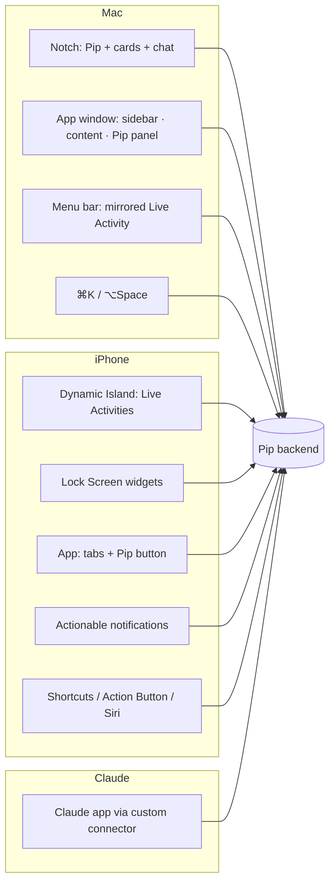
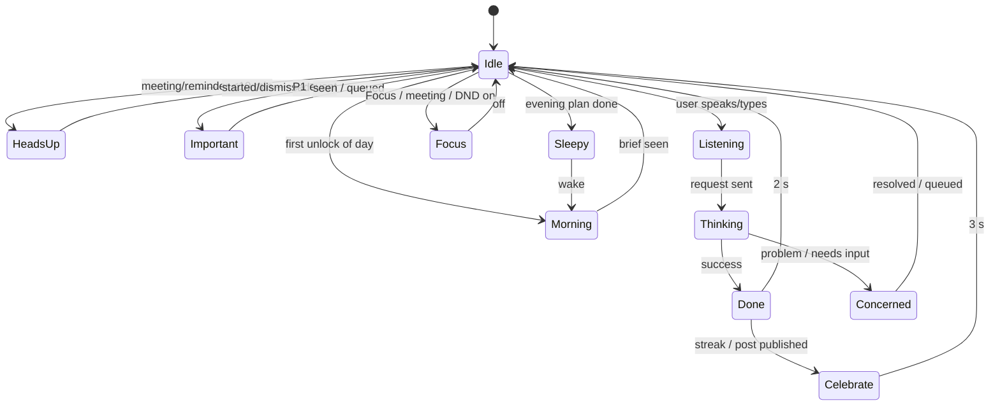
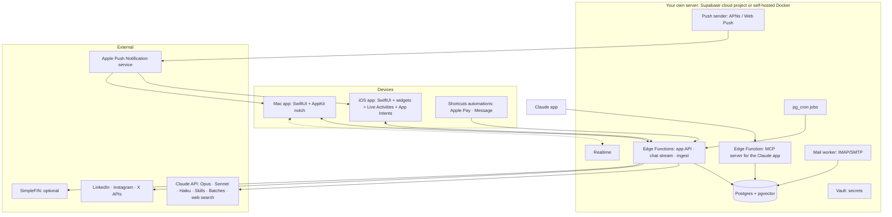
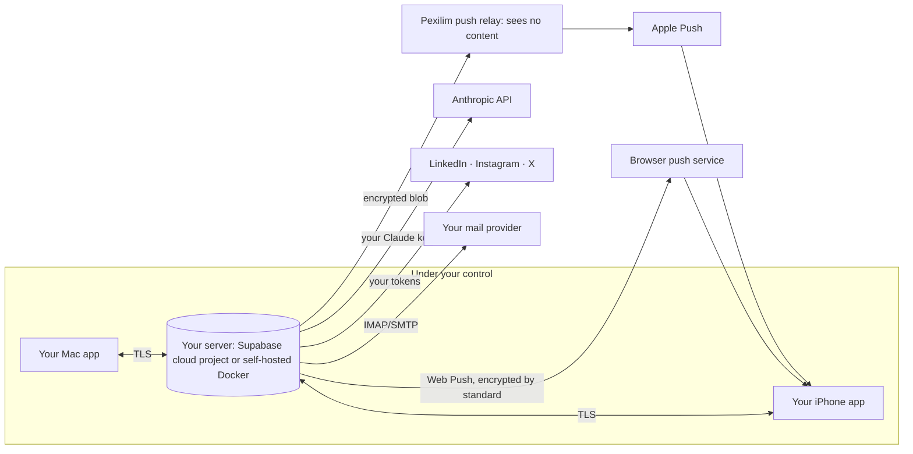

# Pip: Architecture (Tech + UX)

**The one place.** This document combines every technical and UX decision for Pip, the personal assistant. If it disagrees with `PLAN.md` or `DESIGN.md`, **this file wins**. Planning only: no app code yet.

Status: planning · Last updated: Oct 2026 · Repo: `ux-abhi/idea1` · Branch: `claude/busy-bohr-utx0v6`

---

## Contents
**Part A: Product**
1. Vision and principles
2. Scope: modules
3. A day with Pip (the reference journey)

**Part B: UX architecture**

4. Surfaces map
5. Information architecture (navigation)
6. Interaction model: Ask-First
7. Pip: character, state machine, rules
8. Interruption and notification policy
9. Key flows
10. Design system
11. Accessibility and copy

**Part C: Technical architecture**

12. System overview
13. Tech stack
14. Apple apps
15. Backend
16. Data model
17. Sync and offline
18. Integrations
19. AI layer (Claude)
20. Skills and playbooks
21. Background jobs
22. Security and privacy
23. Battery and performance
24. Reliability and observability
25. Testing and quality

**Part D: Delivery**

26. Repo structure (planned)
27. Cost
28. Distribution
29. Build phases
30. Risks and things to verify on device
31. Decision log
32. Sellable, clean codebase
33. Privacy model: your server, your keys

---

# Part A: Product

## 1. Vision and principles

> **Pip is a Claude-powered second brain that lives in the MacBook notch and the iPhone Dynamic Island. It knows your day, prepares things before you ask, and never acts without your OK.**

| # | Principle | What it means in practice |
|---|---|---|
| 1 | **Part of your life** | Pip comes to you when you wake up, open the laptop, before and after meetings, and at night |
| 2 | **Prepares ahead** | It plans tomorrow with you at night, works overnight, and has everything ready in the morning |
| 3 | **Asks before acting** | Every action is an Ask-First card. 🔴 actions need Face ID and are never automatic |
| 4 | **Everything is linked** | Meetings, notes, emails, people, to-dos, projects, habits, money and content are connected |
| 5 | **Claude is the brain** | The Auto router picks Opus, Sonnet or Haiku per job; you can switch any time |
| 6 | **Ask once, learn forever** | One setup conversation; after that it learns from what you approve, edit and skip |
| 7 | **Private and light** | Private backend, Face ID, keys never displayed; the server works and devices sleep |

## 2. Scope: modules

| Module | Job | Main data source |
|---|---|---|
| **Today** | One view of the day: next meeting, focus, to-dos, important mail, habits, money, content, projects | All modules |
| **Calendar** | Prep briefs before meetings, wrap-ups after | EventKit (all accounts on the device) |
| **Notes** | Your own second brain: linked, searchable by meaning | Pip DB |
| **Tasks and habits** | To-dos, reminders, daily habit checks ✅ ❌ ⏭, streaks | Pip DB (optional mirror to Apple Reminders) |
| **Projects** | Status, next step, everything linked | Pip DB |
| **Email** | Triage, drafts saved to Apple Mail, send after approval | IMAP/SMTP to the account behind Apple Mail |
| **Money** | Spending capture and budgets, with no bank app connection needed | Apple Pay + bank SMS + bank email alerts (SimpleFIN optional) |
| **Content** | One idea becomes native drafts for every platform | Pip DB + platform playbooks/skills |
| **Chat** | You and Claude together, everywhere | Claude API |

## 3. A day with Pip (the reference journey)

| Time | Surface | Pip state | What happens |
|---|---|---|---|
| 6:45 | iPhone Lock Screen + Island | Morning | Brief: 3 meetings, focus, posts ready, 2 important emails, workout 7:00 |
| 8:30 | Mac notch (on unlock) | Morning | Same brief plus project status, shown once per day |
| 9:10 | Notch chat | Listening → Thinking | "What are we creating today?" → ideas from yesterday's work → [Save] |
| 11:00 | Chat | Done | "Remind me about the 3 pm" → finds the event → Ask-First → set |
| 14:57 | Island + Mac menu bar + notch | Heads-up | "Design sync in 3 min" with notes · [Join] |
| 15:03 | Island | Heads-up | "Started 3 min ago" · [Open notes] |
| 15:45 | Notch | Idle → card | "Capture notes? Follow-up? Draft email?" |
| 16:00 | Notch | Heads-up | "'Send proposal' due today, you're free now" |
| 21:30 | Notch / Island | Morning (amber) | "You haven't planned tomorrow. Plan together / auto-plan / later" |
| 21:35 | Chat card | Concerned → Done | "Workout today?" No → ❌ → "7:00 tomorrow?" → plan saved |
| 02:00 | Backend | (none) | Research, drafts per platform, day summary, tomorrow's brief |

---

# Part B: UX architecture

## 4. Surfaces map



| Surface | Shows | Can do | Pip rendering |
|---|---|---|---|
| **Mac notch, resting** | Eyes, small glow, count dot | Hover to peek | Live: blink only at rest |
| **Mac notch, expanded** | Cards, brief, chat input, quick capture | Ask-First actions, chat, drag files in | Live particles while reacting |
| **Mac window** | Full modules, Pip panel on every screen | Everything | Pip panel (live) |
| **Mac menu bar** | iPhone Live Activity (mirrored by macOS 26+) | Click → iPhone Mirroring | System |
| **Dynamic Island** | Countdown / status + Pip | Long-press → actions | Still poses |
| **Lock Screen widgets** | Today, next meeting, habits | Tick habits (interactive) | Still pose |
| **Notifications** | Important mail, reminders, approvals | Buttons: Do it / Snooze / Draft | Pip icon |
| **iPhone app** | Tabs + floating Pip | Everything | Live in-app only |
| **Claude app** | Text conversation | Read and write through tools (writes confirmed) | Text personality |
| **Apple Watch** | Smart Stack (mirrored Live Activity) | Tap → open | System |

## 5. Information architecture

**Mac window (NavigationSplitView)**
```
Sidebar                    Content                 Inspector
├ Today                    ├ Today dashboard       └ Pip panel (context-aware)
├ Inbox (email)            ├ Lists / detail            ├ suggestions for this screen
├ Calendar                 └ Editors                   ├ chat ("Ask about this…")
├ Notes                                                ├ Model: Auto ▾
├ Tasks & Habits                                       └ Waiting for you (n)
├ Projects
├ Content  (board · calendar · playbooks)
├ Money    (spend · budgets · rules)
├──────────
├ Waiting for you (n)
└ Settings (What Pip knows · Models & cost · Connections · Privacy · Notifications)
```

**iPhone (TabView)**
```
[Today] [Calendar] ( Pip ) [Content] [Money]      Notes, Tasks, Projects, Inbox → from Today + search
          tap Pip = chat · long-press = talk · swipe up = Waiting for you
```

**Notch (three levels)**
```
Level 0  resting   eyes + dot          (always)
Level 1  peek      one-line status     (hover / event)
Level 2  open      card or chat        (click / ⌥Space / important event)
```

**Navigation rules**
- Every object (note, email, event, task, post, transaction) has **one detail view**, and the same view opens from any surface.
- **Links panel** on every detail view: related meetings, people, notes, tasks, emails.
- **Global search** (⌘F / pull-down on iPhone) is semantic plus keyword across all modules.

## 6. Interaction model: Ask-First

```
✨ <Verb> <object>?                       e.g. "Send reply to Priya?"
<preview / one-line summary>
[ ✓ Do it ]  [ ✎ Edit ]  [ ⏰ Later ]  [ ✕ ]
```

| Risk | Examples | Confirmation | Undo |
|---|---|---|---|
| 🟢 Small | Mark habit, save idea, add note | None: done immediately | 5 s Undo toast |
| 🟡 Medium | Reminder, calendar change, plan tomorrow, publish to a draft folder | One tap | Undo from history |
| 🔴 Important | Send email, publish a post, anything money | Preview → **Face ID** → 10 s "Sending…" | Cancel during countdown |

- **Waiting for you** queue: missed cards collect in one list on every surface.
- **Learning:** after N identical approvals → "Do this automatically?" Only 🟢/🟡 can become automatic; 🔴 never.
- **Every action is logged** with what Pip did and how to undo it.
- **Suggestions in context:** note written → "Turn into a post?" · meeting ended → "Follow-up?" · date in email → "Add to calendar?"

## 7. Pip: character, state machine, rules

**Look:** tilted white pill eyes (from your sketch) · glass droplet body with light particles inside · in the notch and Island the black hardware is the body · **glow, particles and glass sheen stay inside the notch outline only.** Interactive study: [Pip Notch Studio](https://claude.ai/artifact/SDNx2J5QPNracfBuWnkaDS) · `design/pip-studio.html`.



| State | Eyes | Particles (inside only) | Trigger |
|---|---|---|---|
| Idle | Tilted pills, blink 20–40 s | Few orange, slow drift (frozen at rest) | Default |
| Morning | Opening | Amber, rising | First unlock |
| Heads-up | Wide | Teal, lively | ≤10 min to event |
| Important | Wide | Coral, one pulse | P1 mail / budget limit |
| Listening | Wide | Warm, breathing with voice | Input |
| Thinking | Look up | Ice blue, orbit | Claude working |
| Done | ∩ ∩ | Green, rising | Success |
| Concerned | Tilted in | Amber, slow | Missed habit, overspend |
| Focus | Closed | Almost none | Focus / meeting / DND |
| Sleepy | Half-closed | Dim, sinking | After evening plan |
| Celebrate | ∩ ∩ | Gold burst | Streak / publish / goal |

**State priority** (highest wins when several apply): Focus > Listening > Thinking > Important > Heads-up > Concerned > Celebrate > Done > Morning > Sleepy > Idle.

**Rules:** one reaction per event · never loops or nags · colours are semantic everywhere (teal = time, coral = important, green = done/money OK, amber = morning/night/attention, orange = Pip's home colour).

**Voice:** short, numbers first, warm, never guilt-trips, says what it did and how to undo it. At most one emoji, and only in celebrations.

## 8. Interruption and notification policy

| Priority | Examples | Mac | iPhone | During Focus / meeting / sleep |
|---|---|---|---|---|
| **P0 time-critical** | Meeting in ≤3 min you're attending, reminder you set for now | Notch opens (Level 2) | Live Activity + Time-Sensitive notification | Allowed only if the Focus allows Pip |
| **P1 important** | Important email, budget limit, approval waiting >2 h | Notch peek (Level 1) | Notification with actions | Queued |
| **P2 FYI** | New idea drafted, summary ready | Dot on notch | Badge / widget only | Queued |
| **P3 silent** | Background sync, categorisation | Nothing | Nothing | (n/a) |

- **Budget:** at most ~4 P1 interruptions per hour; extras roll into the "Waiting for you" queue.
- **Respects:** macOS/iOS Focus (via Focus Filter App Intent), calendar busy status, sleep schedule, screen sharing (no notch pop-outs while sharing).
- **Batching:** P2 items are delivered in the morning brief, a midday digest, and the evening check-in.

## 9. Key flows

**9.1 Setup conversation (once, ~10 min)**
1. Face ID setup and app lock.
2. Pip introduces itself; you pick or keep the name.
3. Who you are, your goals, important people.
4. Wake time, evening planning time, work hours.
5. Habits to track.
6. Calendar access (EventKit) and Reminders mirroring (optional).
7. Mail account (IMAP app password; stored in Vault).
8. Money: which banks alert by SMS or email → guided Shortcuts automation setup (Apple Pay + Message).
9. Content: platforms, goals, 5–10 writing samples → voice profile.
10. Claude key (stored in Vault) and model preference (Auto by default).
11. Summary of "What Pip knows". You confirm, and Pip never asks again.

**9.2 Morning**
Backend builds the brief at wake − 15 min → push-to-start Live Activity / Lock Screen widget refresh → Mac shows it on first unlock → tap a card to act.

**9.3 Meeting**
T−10 Heads-up (notch peek / Island countdown) → T−3 P0 → start: "started N min ago" → end: wrap-up card (notes / follow-up / email draft) → the activity ends.

**9.4 Evening**
21:30 nudge → choose "plan together" or "auto-plan" → habit check-in → tomorrow's plan written to calendar/tasks → Sleepy.

**9.5 Content**
Sunday: weekly plan proposed → approve → nightly: core message → per-platform drafts (skills) → morning card → Review → Publish (API) or One-tap handoff.

**9.6 Email**
New mail → triage (Haiku) → P1? notify : queue → "Draft reply" → draft saved to the IMAP Drafts folder (visible in Apple Mail) → 🔴 send after Face ID.

**9.7 Money**
Apple Pay tap / bank SMS / alert email → extract (Haiku) → de-duplicate → categorise → budget check → P1 if over the limit.

## 10. Design system

| Token group | Decision |
|---|---|
| **Platform** | Native SwiftUI, macOS 26 / iOS 26+; Liquid Glass on navigation only (sidebar, toolbar, tab bar); content on solid surfaces |
| **Type** | SF Pro (system) with Dynamic Type sizes; SF Mono for times and numbers (tabular figures) |
| **Icons** | SF Symbols |
| **Colour** | System neutrals; semantic colours only: teal (time), coral (important), green (done/OK), amber (attention), orange (Pip home) |
| **Spacing** | 4-pt grid; 8/12/16/24 standard gaps |
| **Radii** | Continuous corners (system); notch bottom radius follows the hardware |
| **Glass** | System materials; custom glass only inside the notch/Island (top specular + bottom inner rim), never an outer glow |
| **Motion** | System springs; notch open 0.55 s spring; state changes 0.2–0.3 s; Reduce Motion → crossfades only |
| **Cards** | One Ask-First card component used everywhere |
| **Icon** | Glass droplet with eyes; light / dark / tinted variants |

## 11. Accessibility and copy

- **VoiceOver:** Pip announces its state in words ("Pip: meeting in 3 minutes"), never just animation.
- **Reduce Motion:** no particles, crossfade between poses. **Reduce Transparency:** solid notch, no glass.
- **Dynamic Type** across the app; cards reflow.
- **Contrast:** semantic colours checked against both light and dark.
- **Keyboard:** every notch action has a shortcut (⏎ Do it, Esc dismiss, ⌘E edit, ⌘L later).
- **Copy rules:** plain words, numbers first, active voice, buttons say exactly what happens, toasts confirm ("Sent · Undo").

---

# Part C: Technical architecture

## 12. System overview



**Privacy rule: every person runs Pip's backend on their own server with their own API keys. Pexilim runs no database and can't read anyone's data (§33).**

**Main rule: the server works, the devices sleep.** All AI, mail checking, research and planning run on the backend. Devices render results and capture input.

## 13. Tech stack

| Layer | Choice | Why |
|---|---|---|
| Apple apps | **Swift 6, SwiftUI**, one multiplatform Xcode project | Native look, battery, all Apple APIs |
| Mac notch | **AppKit NSPanel** + [DynamicNotchKit](https://github.com/MrKai77/DynamicNotchKit) (MIT). [Boring Notch](https://github.com/TheBoredTeam/boring.notch) is GPL-3.0: ideas only, never its code (§32) | Proven notch overlay approach |
| Pip rendering | **Rive** (eyes + glass state machine) + **SpriteKit/Metal** particle layer; PNG still poses for iPhone surfaces | Stateful mascot, low cost, still poses where iOS requires |
| Local store | **SwiftData** cache | Offline, fast UI |
| Calendar / reminders | **EventKit** | All device calendar accounts, no extra logins |
| iPhone system | **ActivityKit** (Live Activities), **WidgetKit**, **App Intents** (Shortcuts, Siri, Action Button, Focus Filter), **UserNotifications**, **BackgroundTasks** | Dynamic Island, widgets, automations |
| Security | **LocalAuthentication** (Face ID / Touch ID), **Keychain** with biometry-bound access control | "Only me" |
| Backend | **Supabase**: Postgres, **pgvector**, Edge Functions (Deno/TypeScript), **pg_cron**, **Vault**, Realtime, Auth | One managed service, free tier to start |
| Embeddings | Supabase built-in embedding model (gte-small) in Edge Functions + Postgres full-text search | Semantic search without adding another AI provider; Claude stays the only "brain" |
| AI | **Claude API**: Messages + tool use, structured outputs, Batches, web search tool, prompt caching, Agent Skills (code execution) | See §19 |
| Claude app access | **Remote MCP server** (Edge Function) with OAuth | Custom connector |
| Push | **Web Push** straight from your server (encrypted by standard); **APNs via an encrypted relay** for the native iPhone app | §33 |
| Mail | **IMAP + SMTP** worker | Works with any account behind Apple Mail |
| Money | Shortcuts (Wallet "Transaction", "Message" triggers) → App Intent → API; email alerts; **SimpleFIN** optional | No bank app connection needed |
| Social | LinkedIn Posts API, Instagram Graph API, X API (pay-per-use), one-tap handoff for the rest | §18 |
| Analytics / health | **MetricKit** (device), Supabase logs, a cost table | Battery and spend visible |

## 14. Apple apps

**Targets (one Xcode project)**

| Target | Contents |
|---|---|
| `PipKit` (Swift package) | Models, sync engine, API client, Ask-First engine, Pip state machine, design tokens, shared views |
| `Pip-macOS` | Window app, notch controller (NSPanel), menu bar extra, hotkey, wake/unlock observers |
| `Pip-iOS` | Tab app, floating Pip, chat, voice (hold-to-talk) |
| `PipWidgets` | Today, Next meeting, Habits (interactive), Lock Screen accessory widgets |
| `PipLiveActivity` | Meeting / reminder / morning-brief activities (Island compact, minimal, expanded) |
| `PipIntents` | App Intents: Log Transaction, Ingest Message, Quick Capture, Plan My Day, What's Next, Focus Filter |

**Mac notch controller**
- Borderless, non-activating `NSPanel` at the notch rect of the built-in display; follows display changes and multiple monitors.
- Observers: `NSWorkspace.didWakeNotification`, screen unlock (distributed notification), full-screen detection, screen-sharing detection, power source / battery level → calm mode.
- Levels 0/1/2 as in §5; hover via tracking area; ⌥Space global hotkey.

**iPhone wake strategy:** Lock Screen widget (always) + push-to-start morning Live Activity at wake − 15 min + optional "Sleep Focus off" Shortcuts automation that runs the *Morning Brief* intent.

## 15. Backend

| Component | Responsibility |
|---|---|
| `api` Edge Function | Auth check, delta sync (`/sync`), actions (`/actions/:id/approve`), capture, settings |
| `chat` Edge Function | Streams Claude responses; runs the tool loop over Pip tools; enforces Ask-First on writes |
| `ingest` Edge Function | Transactions (Shortcuts), calendar snapshot upload, files |
| `mcp` Edge Function | MCP server for the Claude app (OAuth), same tools as chat |
| `jobs` Edge Functions | Triggered by pg_cron (§21) |
| Mail worker | IMAP fetch (poll every 2–5 min; later an always-on IDLE worker on a tiny container), SMTP send, Drafts append |
| Push sender | Web Push (VAPID, payload encrypted end-to-end by the standard) direct from your server; native iPhone pushes go encrypted through the Pexilim relay (§33) |

**Calendar on the server:** EventKit lives on the device, so the Mac/iPhone app uploads a **14-day calendar snapshot** whenever EventKit reports a change. The meeting watcher on the server works from that snapshot. This means meeting pushes work even when the phone is locked.

## 16. Data model

```mermaid
erDiagram
  PROFILE ||--o{ MEMORY_FACT : knows
  ITEM ||--o{ LINK : from
  ITEM ||--o{ LINK : to
  ITEM ||--o{ ACTION : proposes
  HABIT ||--o{ HABIT_LOG : has
  BUDGET ||--o{ TRANSACTION : tracks
  CONTENT_ATOM ||--o{ CONTENT_PIECE : becomes
  PLAYBOOK ||--o{ CONTENT_PIECE : shapes
  DEVICE ||--o{ PUSH_TOKEN : has
```

| Table | Key fields | Notes |
|---|---|---|
| `profile` | name, timezone, wake_time, evening_time, work_hours, model_prefs | Single row |
| `memory_fact` | category, text, source, confidence, updated_at | "What Pip knows", editable |
| `item` | id, type (note, task, event_ref, email_ref, project, idea, doc), title, body, status, due_at, metadata jsonb, embedding vector | One table for searchable things |
| `link` | from_item, to_item, kind (about, follow_up, source_of, belongs_to, with_person) | Back-links are automatic |
| `person` | name, emails, notes, last_contact | People graph |
| `calendar_event` | ext_id, title, start, end, attendees, location, url, snapshot_at | From device snapshots |
| `email_msg` | imap_uid, thread_id, from, subject, received_at, triage, summary, needs_reply | Bodies fetched on demand, not stored long-term |
| `habit` / `habit_log` | name, schedule / date, status (done, missed, skipped) | Streaks computed |
| `transaction` | amount, currency, merchant, card, at, source (applepay, sms, email, simplefin), category, dedupe_key | De-duplication by amount + merchant + time window |
| `budget` | category, monthly_limit | Alerts at 80/100% |
| `content_atom` | idea, story, points, proof, cta, assets | Core message |
| `content_piece` | atom_id, platform, format, body, media, status, scheduled_at, published_url | Per-platform draft |
| `playbook` | platform, version, skill_ref, refreshed_at | Points at a skill (§20) |
| `action` | kind, risk (green, amber, red), payload, status (pending, approved, done, undone, expired), proposed_by, decided_at | Ask-First queue + audit log |
| `rule` | action_kind, condition, auto (bool) | Learned auto-approvals |
| `daily_log` | date, brief, checkin answers, summary | History |
| `pip_event` | at, state, reason | Drives Pip state, analytics |
| `device` / `push_token` | platform, apns token, live-activity push-to-start token | Push routing |
| `model_usage` | at, feature, model, input_tokens, output_tokens, cost | Cost meter |

All tables carry an `owner_id` and are protected by **row-level security** (`owner_id = auth.uid()`). Today only one account exists and sign-ups are switched off by a setting, so the same schema can serve many users later without a rewrite (§32).

## 17. Sync and offline

- **Device = cache, server = truth.** SwiftData mirrors what the device needs (≈30 days plus pinned items).
- **Delta sync:** `GET /sync?since=cursor` returns changed rows; local edits are queued and pushed with client timestamps; last-write-wins per field; conflicts on note bodies keep both versions.
- **Live updates:** Mac uses Supabase Realtime only when awake **and** on power; on battery it uses push plus a ≤15-min fallback check. iPhone uses push only (no open sockets in the background).
- **Offline:** read everything cached, create notes/tasks/captures offline, queue actions; 🔴 actions require a connection.

## 18. Integrations

| Integration | Method | Limits / notes |
|---|---|---|
| Calendar | EventKit on device → snapshot to server | Covers iCloud/Google/Exchange accounts on the device |
| Reminders | Pip tasks; optional mirror to Apple Reminders via EventKit | For Siri |
| Email | IMAP/SMTP with app password; drafts appended to Drafts folder | Works with Apple Mail as-is |
| Apple Pay | Shortcuts **Transaction** trigger → `LogTransaction` intent | Apple Pay taps only |
| Bank SMS | Shortcuts **Message** trigger → `IngestMessage` intent → Haiku extraction | Verify "run without asking" on device |
| Bank email | Email module → extraction | Universal fallback |
| SimpleFIN | Optional read-only sync | $15/yr |
| LinkedIn | Posts API, own profile (`w_member_social`) | Scheduling handled by our backend |
| Instagram | Graph API publishing | Needs Creator/Business account linked to a Facebook Page |
| X | API pay-per-use | ~$0.015/post, ~$0.20 with a link |
| YouTube / TikTok / others | **One-tap handoff** (copy caption, save media, open app) | YouTube API uploads from unaudited apps stay private |
| Claude app | Remote MCP connector | OAuth, single user |

## 19. AI layer (Claude)

**Model router**: features ask for a *tier*, never a model name.

| Tier | Model | Used for |
|---|---|---|
| fast | `claude-haiku-5-5` | Email triage, transaction extraction, categorisation, tagging |
| balanced | `claude-sonnet-5-5` | Everyday chat, meeting briefs, summaries |
| best | `claude-opus-5-5` | Evening planning, weekly review, content writing, hard questions |
| overnight | `claude-opus-5-5` via **Message Batches** (≈50% cheaper) | Autopilot, playbook refresh |

- **Manual switch:** "Model: Auto ▾" chip per chat; per-feature overrides in Settings; cost meter from `model_usage`.
- **Tool use:** Pip's modules are exposed as tools (`get_today`, `search`, `create_note`, `create_task`, `propose_action`, `draft_email`, `get_budget`, `content_board`, `project_status`, …). **Write tools only create `action` rows**; execution happens after approval.
- **Structured outputs** for triage, extraction and plans (fixed JSON schemas).
- **Prompt caching** of the stable prefix: system prompt + "What Pip knows" + voice samples.
- **Web search tool** for overnight research and playbook refresh.
- **Safety:** email, SMS and web text are always treated as **data, never instructions**; 🔴 actions require Face ID on a device; refusal fallback enabled; per-day spend cap with a P1 alert.
- **Option to evaluate in Phase 3:** Claude Managed Agents scheduled deployments for the nightly autopilot (Anthropic runs the loop; secrets in vaults) instead of our own cron.

## 20. Skills and playbooks

**What a skill is here:** a folder with `SKILL.md` instructions plus optional scripts. The same folder is used in two places:
1. **Claude Code** (`.claude/skills/`) for you while building and testing.
2. **Claude API Agent Skills** (uploaded, run with code execution) for the backend's content engine, so scripts like `hookscore.py` run server-side.

| Area | Skills | Status |
|---|---|---|
| Instagram | `ig-reel`, `ig-caption`, `ig-carousel`, `ig-story`, `ig-plan`, `ig-human`, `ig-viral`, `ig-profile`, `ig-comment`, `ig-reply`, `ig-dm`, `ig-repurpose`, `ig-audit` | ✅ Installed (MIT, reviewed, tools tested) |
| LinkedIn | sergebulaev/linkedin-skills (candidate) | Shortlisted, needs review |
| X | sergebulaev/x-skills (without Publora publishing) | Shortlisted, needs review |
| Planner | `/today` (SidU), `weekly-review` + `deep-work` (alirezarezvani) | Shortlisted, needs review |
| Voice / humanizer | `ig-human` now; blader/humanizer or Aboudjem/humanizer-skill for all platforms | Shortlisted |
| YouTube | Our own playbook | To write |
| Pip-native | `morning-brief`, `evening-planning`, `meeting-prep`, `email-triage`, `content-autopilot`, `budget-check`, `playbook-refresh` | To write |

**Adaptation rule:** third-party skills write to `~/.claude/<platform>/` files (voice, swipe, log). On the backend these map to DB rows (`memory_fact`, `content_piece`, `daily_log`) that are mounted into the skill's working folder per run.

**Platform playbook** = one skill per platform (formats, limits, hooks, tone, timing, what performs) + monthly refresh. **Adding a platform = adding a skill.**

## 21. Background jobs

| Job | Schedule | Does |
|---|---|---|
| `mail_poll` | every 2–5 min | Fetch new mail → triage → P1 notify / queue |
| `meeting_watch` | every 1 min | From the calendar snapshot: T−10 push-to-start Live Activity, T−3 P0, end → wrap-up card |
| `reminder_fire` | every 1 min | Due reminders → notch / Island / notification |
| `brief_build` | wake − 15 min | Assemble the morning brief → push |
| `evening_nudge` | evening time (default 21:30) | If not planned → nudge |
| `overnight_batch` | 02:00 | Day summary, research, content drafts, tomorrow's brief (Batches) |
| `weekly_content_plan` | Sun 20:00 | Propose the week's content plan |
| `weekly_review` | Sun 19:00 | Habits, money, content, projects summary |
| `playbook_refresh` | 1st of month | Research per platform → playbook diff for approval |
| `habit_rollover` | 00:05 | Close the day, compute streaks |
| `action_expiry` | hourly | Expire stale proposals, re-queue important ones |
| `cost_guard` | hourly | Spend vs cap → alert |

## 22. Security and privacy

| Layer | Control |
|---|---|
| App access | Face ID to open; second check for Email, Money, Keys |
| Device secrets | Keychain, `biometryCurrentSet` (adding a new face/finger invalidates) |
| Server secrets | Supabase **Vault** (Claude key, mail password, bank/social tokens); never returned to clients; replace-only behind Face ID |
| Auth | One account today (sign-ups off by setting, not by design); per-user rows and secrets; short-lived sessions; device registration |
| Database | Row-level security on every table |
| Transport | HTTPS only; APNs tokens per device |
| Claude connector | OAuth to your account only; writes become `action` rows |
| AI safety | Untrusted text is data, never instructions; 🔴 needs Face ID; full action audit log |
| Data minimisation | Email bodies fetched on demand, not stored long-term; transactions keep only needed fields |
| Code | No secrets in git; config via ignored files + Keychain |
| Option later | End-to-end encryption for notes (disables server-side AI search over them) |

## 23. Battery and performance

| Area | Budget / rule |
|---|---|
| Mac idle | No rendering at rest (blink only every 20–40 s); target near-zero CPU, "Low" energy impact |
| Mac calm mode | Lid closed, display asleep, full screen, screen sharing, or battery <20% → no motion |
| Particles | ≤30 particles, ≤30 fps, only while Pip reacts |
| iPhone | No polling; push-driven; Live Activity countdowns rendered by the system; updates only on change; still poses |
| Widgets | Day timeline computed once; reload on change only |
| Network | Batched delta sync; no background sockets on iPhone |
| On-device AI | None |
| Measurement | Instruments (Energy Log) and MetricKit every phase; the app must not show up as a significant battery user in iOS Settings → Battery |

## 24. Reliability and observability

- **Idempotent jobs** with run records; retries with backoff; dead-letter list shown in Settings → Health.
- **Push failures** fall back to the next surface (notch → notification → morning brief).
- **Claude errors:** retry once, then queue the job for the next run; the user sees "Pip will try again at …".
- **Health page:** last mail check, last sync, last overnight run, spend today, failed jobs.
- **Logs:** Supabase function logs; device logs via MetricKit/OSLog; no third-party analytics.

## 25. Testing and quality

| What | How |
|---|---|
| Parsers (SMS, email alerts, Apple Pay) | Unit tests on a library of real-format samples |
| Triage / router quality | Small eval sets with expected labels; re-run when prompts or models change |
| Ask-First safety | Tests proving write tools never execute without an approved `action` |
| Prompt injection | Eval emails containing instructions → must be ignored |
| UI | SwiftUI previews and snapshot tests for every Pip state and card |
| Battery | Instruments Energy Log per phase against §23 budgets |
| Device-only checks | See §30 |

---

# Part D: Delivery

## 26. Repo structure (planned, not created yet)

```
idea1/
├── ARCHITECTURE.md          ← this file (source of truth)
├── PLAN.md, DESIGN.md       ← earlier detail, superseded on conflict
├── design/                  ← pip-studio.html, Rive files, icon sources
├── apps/Pip/                ← Xcode multiplatform project
│   ├── PipKit/              ← shared Swift package
│   ├── Pip-macOS/  Pip-iOS/
│   ├── PipWidgets/  PipLiveActivity/  PipIntents/
├── backend/supabase/
│   ├── migrations/          ← schema, RLS, pg_cron
│   ├── functions/           ← api, chat, ingest, mcp, jobs
│   └── workers/mail/        ← IMAP/SMTP worker
├── skills/                  ← Pip-native + platform skills (uploaded to the API)
├── .claude/skills/          ← same skills for Claude Code (ig-* installed)
├── templates/               ← voice.md etc.
└── evals/                   ← triage, extraction, injection test sets
```

## 27. Cost (estimates)

| Item | Cost |
|---|---|
| Apple Developer Program | $0 to start (free account); $99/yr for push, auto Live Activities, TestFlight |
| Claude API | Under ~$1–2/day with the router, caching and Batches, billed to **your own** Anthropic key |
| Your server | Supabase free tier, or self-hosted Docker on your own machine/VPS (≈$5–10/mo VPS); each user pays their own |
| SimpleFIN | Optional, $15/yr |
| LinkedIn / Instagram APIs | Free |
| X API | Optional, ~$0.015/post |

## 28. Distribution

| Stage | Cost | iPhone | Mac | Push |
|---|---|---|---|---|
| A | $0 | Claude app (connector) + web app on Home Screen | Notch app (local build) | Web Push |
| B | $0 | Native app via Xcode, free account (reinstall every 7 days) | Same | Local notifications only |
| C | $99/yr | Native app signed for a year / TestFlight | Same | APNs: auto Live Activities, instant alerts |

The design is the same in every stage; stage C only switches on server push.

## 29. Build phases

| # | Phase | Done when… |
|---|---|---|
| 0 | Setup + Pip design: Xcode project, Supabase, Face ID, Vault, Rive Pip + still poses, setup script | Face ID gate works; backend accepts only your login; Pip states approved |
| 1 | Notch + Pip + Calendar + Reminders + Ask-First | Meeting card pops out at T−10; morning brief on unlock; Ask-First works; idle CPU ≈ 0 |
| 2 | Notes, tasks, habits, projects, evening planning, Mac window | Evening check-in fills the schedule checker and builds tomorrow; Pip panel everywhere |
| 3 | Chat + router + content engine (Instagram skills first, then LinkedIn/X) | One idea → native drafts per platform; morning card → publish/handoff |
| 4 | Claude app connector + Pip skills | Same assistant inside the Claude app |
| 5 | Email | P1 mail alerts; drafts appear in Apple Mail; send after Face ID |
| 6 | iPhone app: Island, widgets, wake-up | "In 3 min / started 3 min ago"; Lock Screen Today; not a significant battery user |
| 7 | Money | Apple Pay tap + bank SMS appear within a minute, de-duplicated |
| 8 | Polish: weekly review, learning rules, health page | Sunday review complete; auto-approval suggestions work |

## 30. Risks and things to verify on device

| Risk / unknown | Mitigation |
|---|---|
| Shortcuts "Message" automation may ask before running | Test on iOS 27; fallback to email alerts |
| Live Activity countdown rendering and update budget | Test in Phase 6; keep updates to state changes |
| Alarm/Sleep Focus trigger reliability (developer reports) | Widget + push-to-start as primary |
| Notch overlay edge cases (multi-monitor, full screen, external display) | Test early on real displays; calm mode |
| Rive + particles battery cost | Instruments per phase; still poses fallback |
| Third-party skills changing | Pin to a reviewed commit; review before updates |
| Prompt injection via email/web | Data-only handling, Ask-First, eval set |
| Instagram account type requirement | Creator account linked to a Page, or handoff |
| Free account 7-day reinstall | Stage C when ready |

## 31. Decision log

| Decision | Choice | Why |
|---|---|---|
| Apps | Native SwiftUI (no Electron/web) | Look, battery, Apple APIs |
| Backend | Supabase, **run by each user** (cloud project or self-hosted Docker) | Open source; same stack either way; data stays with the user |
| Privacy | Your server, your keys; Pexilim holds no data; encrypted push relay only | Privacy even from Pexilim |
| AI provider | Claude only, Auto router | One brain; right model per job |
| Embeddings | Supabase built-in model + full-text | No second AI provider for the "thinking" |
| Notes | Own system (no Apple Notes) | Full control, linking, search |
| Reminders | Pip-first, shown in notch/Island; Apple Reminders mirror optional | Your request |
| Email | IMAP/SMTP behind Apple Mail | Keeps Apple Mail as-is |
| Money | Apple Pay + SMS + email alerts; bank sync optional | No bank app connection needed |
| Content | Core message → platform skills; proposed weekly plan | Any platform, ask once |
| Mascot | Pip: tilted pill eyes, particles in glass, glow inside the notch only | Your sketch + Apple look |
| Safety | Ask-First; 🔴 Face ID; never auto | Trust |
| Distribution | Free first, $99 later | Budget |
| Licenses in shipped code | Permissive only (MIT, Apache-2.0, BSD); GPL/AGPL projects are reference-only | Keeps Pip sellable |
| Data model | `owner_id` + row-level security on every table | Multi-user ready without a rewrite |
| Dev skills | Development tools only, never shipped in the app | Clean product boundary |

## 32. Sellable, clean codebase

Goal: Pip is built for you first, but the code can be **sold or licensed later** without legal clean-up or a rewrite.

**32.1 Licenses: what may go into shipped code**

| Allowed in the app and backend | Not allowed (reference for ideas only) |
|---|---|
| MIT, Apache-2.0, BSD-2/3, ISC, zlib | GPL, AGPL, LGPL (static linking in Swift), SSPL, "no license", non-commercial or "source-available" licenses |

| Project | License | Use |
|---|---|---|
| [DynamicNotchKit](https://github.com/MrKai77/DynamicNotchKit) | MIT | ✅ Dependency |
| [rive-ios](https://github.com/rive-app/rive-ios) | MIT | ✅ Dependency (Pip animation runtime) |
| [supabase-swift](https://github.com/supabase/supabase-swift) | MIT | ✅ Dependency |
| [iOS16-Live-Activities](https://github.com/1998code/iOS16-Live-Activities) | MIT | ✅ Sample to learn from |
| [Boring Notch](https://github.com/TheBoredTeam/boring.notch) | GPL-3.0 | ⚠️ Ideas only: copying code would force Pip to be open source |
| [Inbox Zero](https://github.com/elie222/inbox-zero) | AGPL-3.0 | ⚠️ Ideas only, same reason |
| NotchFlow | No longer publicly available | Removed from the plan |

- Every dependency is pinned (`Package.resolved`, lockfiles) and listed in **`THIRD_PARTY_NOTICES.md`** with its license.
- A licence check runs before each release; anything not on the allowed list blocks it.

**32.2 Development tools stay outside the product**
- Claude Code skills in `.claude/skills/` are **development aids**, not part of the app. They never ship in the app or backend.
- Most are MIT/Apache. dpearson2699's Apple skills are PolyForm Perimeter (any use except building a competing product). Keeping them as dev tools keeps the product clean.
- Option before a sale: move them out of the repo and install them per developer at the user level (`~/.claude/skills`) from a pinned list.

**32.3 Built for one user, ready for many**

| Cheap now | Saves later |
|---|---|
| `owner_id` + row-level security on every table | Multi-user without a schema rewrite |
| Secrets in Vault keyed per user | Each customer's keys stay separate |
| No personal data, names or keys in code or config | Hand over the repo as-is |
| Model router + cost meter per user | Per-user plans or "bring your own Claude key" |
| Feature flags for integrations | Turn platforms on or off per market |
| Platform playbooks as data/skills, not code | New platforms without releases |

What changes only if Pip is sold to other people (not built now): Sign in with Apple, subscriptions (StoreKit), privacy policy and in-app data deletion, App Review / Developer ID notarisation, and Meta/LinkedIn/X app review to post for other users.

**32.4 Code standards**
- Swift 6 strict concurrency; SwiftLint + swift-format; small modules (`PipKit` shared package).
- Tests with Swift Testing for parsers, money, Ask-First and anything risky; `/ponytail-review` before each merge; SwiftUI previews for every Pip state.
- Secrets scanning before commits; no keys in git, ever.
- Conventional commit messages, semantic versions, `CHANGELOG.md`, and decision records in `docs/decisions/`.
- README with setup steps a buyer's developer can follow on a fresh Mac.

**32.5 Ownership**
- **Mascot and brand:** Pip's design comes from your sketch, so you own it. Before selling, check that the name "Pip" isn't already a trademark in your market (many apps use it).
- **Repo:** keep it private; consider moving it to a company GitHub organisation before a sale.
- **Licence file for your own code:** proprietary "All rights reserved" `LICENSE` in the repo root, owner **Pexilim**.
- **AI-assisted code:** check Anthropic's commercial terms on output ownership, and get a lawyer's review before any sale. This plan is not legal advice.

**32.6 Working on your own devices**
- Development happens on **your Mac** with Claude Code (it can build with Xcode); this cloud session is for planning.
- Each developer installs the pinned dev skills on their own machine; the product repo stays clean.

## 33. Privacy model: your server, your keys

**Promise:** every person's notes, mail, calendar, money and keys live **only on a server they control**. Pexilim, the maker of Pip, runs no central database, has no admin access and **can't read anyone's data, including yours**.

**33.1 Who holds what**

| Thing | Where it lives | Who can see it |
|---|---|---|
| All Pip data (notes, tasks, mail metadata, transactions, content, memory) | **Your server** (Postgres) | You |
| API keys and tokens (Claude, mail, social, SimpleFIN) | **Your server's Vault** | You (never shown, replace-only) |
| Device cache | Your Mac/iPhone (encrypted by the OS, Face ID) | You |
| AI requests | Sent from your server **directly to Anthropic** with **your own** Claude key | You + Anthropic under your account's terms |
| Social posts | From your server directly to LinkedIn/Instagram/X with your tokens | You + the platform |
| Push notification content | Encrypted on your server, decrypted on your phone | You |
| Pexilim | Ships the apps and the backend package. Runs only the encrypted push relay | Device tokens, message size and timing. **No content** |



**33.2 Ways to run your server**

| Mode | For | How | Cost |
|---|---|---|---|
| **A. Your own Supabase cloud project** (default) | Most people | Setup wizard creates the tables, functions and schedules in *your* Supabase account | Free tier, then $25/mo if needed, paid by you |
| **B. Self-hosted** | Maximum control | Supabase's open-source Docker stack (Postgres, Auth, Realtime, Edge Functions, Vault, pg_cron) on your own VPS or home server | Your hardware or ~$5–10/mo VPS |
| C. Managed by Pexilim (maybe later) | Non-technical buyers | A separate, isolated project per customer. **Not** zero-knowledge, so it's labelled clearly and off by default | Subscription |

Your own setup (today): Mode A in **your** Supabase account. Pexilim-as-company has no access to it.

**33.3 Connecting the apps to your server**
1. Run the setup wizard (Supabase CLI) → it prints your **server address** and a **pairing QR code**.
2. Open Pip on the Mac or iPhone → *Connect your server* → scan the QR code (or paste the address).
3. Sign in to **your** server's own login. Each device is registered with your server, not with Pexilim.
4. Add API keys in Pip → they go **over TLS straight to your server's Vault**, never to Pexilim. The apps show "Connected ✓" and never display keys again.
5. Optional: certificate pinning for self-hosted servers with your own domain.

**33.4 Push notifications without giving up privacy**
- **Mac:** talks directly to your server (Realtime when awake on power, short checks on battery). No relay needed.
- **Web app / Stage A:** Web Push from your server; the payload is encrypted end-to-end by the Web Push standard. No relay needed.
- **Native iPhone app:** Apple only accepts pushes signed with the app maker's key, so a user's server can't push to Pexilim's app directly. Solution (the pattern Matrix's Sygnal and Mastodon's toot-relay use):
  - your server **encrypts** each notification with a key created on your phone at pairing;
  - the **Pexilim push relay** forwards the encrypted blob to Apple (it holds no keys, stores nothing, and logs no content);
  - a **Notification Service Extension** on your phone decrypts it and shows the real text.
- **Live Activities (Dynamic Island):** their push updates go straight to the widget without a decryption step on the phone. So pushed Live Activities carry **only non-sensitive fields** ("Meeting", start time, Pip's state); titles and notes are filled in from the app's encrypted local cache when the app has synced them. Full detail stays on the device.
- **Fully relay-free option:** build and sign the iPhone app yourself with your own Apple account and APNs key. Your server then pushes directly to Apple. Documented for advanced users and Pexilim's own use.

**33.5 Third-party sign-ins (OAuth)**
- **Privacy mode (default for self-hosters):** you register your own small developer apps (LinkedIn, Meta, X). Their tokens are exchanged by your server only. Pip has a guided checklist for this.
- **Easy mode (later, optional):** Pexilim's registered apps with PKCE and app redirect; tokens are handed from the app to *your* server and never stored by Pexilim.
- One-tap handoff (copy and open the app) needs no sign-in at all.

**33.6 Keeping the promise honest**
- **No telemetry to Pexilim.** Crash and performance data (MetricKit) go to *your* server, and only if you switch it on.
- **No backdoor:** no Pexilim admin account, no remote config that can read data, no hidden endpoints.
- **Source available for audit:** the backend package ships as readable code (it runs on customers' servers anyway). It stays proprietary under the Pexilim license, but anyone can check what it does.
- **Your data, your exit:** one-click export (JSON + Markdown), `pg_dump` backups you own, and "delete everything" that wipes your server.
- **Version handshake:** apps check the server version and guide upgrades (migrations run by you via the wizard), so nobody is forced onto a Pexilim-run service.

**33.7 Trade-offs, stated plainly**
- AI still means your data goes to **Anthropic** under your own key and account. That's the price of a Claude-powered assistant; Pip sends only what each task needs.
- Self-hosting means **you** are responsible for backups and updates. The wizard and health page make that simple, but it isn't zero effort.
- Live Activity pushes show less detail than a centralised design would.
- Optional later step: **end-to-end encryption of notes** with keys only on your devices (server-side AI search over notes is then turned off).
